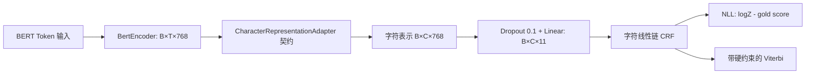

# BERT-CRF 阶段 1B：字符级核心模型与人工 Smoke Test

日期：2026-10-19，Asia/Shanghai。运行 ID：`20261019T174356+0800_stage1b`。
所有运行统一标记为 `stage1b_core_smoke_test`。

**本轮验收通过：53/53 自动测试通过，包含实际预训练 BERT 的 GPU 前反向、人工一对一映射及保存重载。真实 Token→字符适配仍未实现，等待阶段 1C。**

本轮没有读取真实数据集标签、微调数据集、执行优化器更新、参数实验、F1 评估或正式预测。本文是技术实现与程序验证记录，不是课程最终实验分析或个人贡献声明。

## 1. 源码、配置与结构

新增文件均属于本人 BERT-CRF 模块：

```text
src/bert_crf/
  __init__.py       独立模块入口
  config.py         模型/运行配置与显式种子设置
  constraints.py    固定 11 标签顺序与 strict_bio_v1 规则
  crf.py            原创 PyTorch 线性链 CRF
  model.py          BertEncoder、抽象 Adapter、CharacterCRFHead、组合及保存加载
tests/bert_crf/
  conftest.py       人工测试种子、显式权重/证据路径参数
  test_constraints.py
  test_crf.py
  test_model.py     含测试专用 SyntheticOneToOneAdapter
  test_pretrained.py
configs/bert_crf/stage1b_core_smoke.json
pytest.ini
docs/bert_crf/stage1b_runner.py
docs/bert_crf/stage1b_finalize.py
docs/bert_crf/02_model_core_and_smoke_tests.md
```



图中的 Adapter 是抽象契约，不能直接实例化。本轮**仅测试代码**提供一对一 gather，且先用真实 Fast Tokenizer 检查两个人工文本每字符恰有一个 Token；不处理一般多字符 Token、空白缺失或长句。

实测参数量：BERT encoder（不含 pooler）101,677,056；字符 Head 8,602（Linear 8,459，CRF 143）；合计 **101,685,658**，均可训练。BERT 隐层 768，11 标签顺序与已有公共接口一致，没有 PAD 输出类别。

配置文件明确记录模型名、固定 revision、隐藏维度、标签顺序、Dropout、约束开关与规则版本、seed=1729、CUDA、float32、确定性算法。配置加载会拒绝未知规则、错误标签表和未验收的混合精度；没有训练学习率等隐含正式参数。CPU 单元测试使用显式缩小的随机 BERT，不能冒充预训练模型测试。

## 2. CRF 选型与实现契约

本环境未安装 torchcrf/TorchCRF。本轮选择独立、简洁的 PyTorch 线性链 CRF，以直接审查训练和解码是否共享严格约束；没有引入或复制第三方 CRF 源码，也没有声称所有第三方库都不支持约束。CRF 是本轮新实现，未为本项目擅自增加开源许可证。PyTorch 为 BSD-3-Clause、Transformers 和该预训练模型为 Apache-2.0；模型卡随固定 revision 保存在忽略目录。环境版本见下文及 freeze。

状态分数采用：起始分数 + 各字符发射分数 + 相邻转移分数 + 终止分数。转移矩阵索引为 `[previous_tag,next_tag]`；起始、转移和终止分数都可训练。NLL 默认按样本平均；另支持逐样本和总和。

- 句首禁止 I；I-X 的前驱只能是同类 B-X/I-X；所有 O/B 后继允许，包括同类 B→B；所有标签可终止。
- 11 标签中允许 6 个句首标签、76 条转移。每次计算以固定 Bool 规则屏蔽非法参数为**负无穷**，覆盖分区函数、金标评分和 Viterbi，不是初始化为小数，也没有预测后修补。
- 非法金标立即报错；不修改标签。分区函数使用 logsumexp，Mask 更新使用 where，避免 `0 × -inf`。禁止路径的参数梯度为零。
- 字符 Mask 必须是 Bool `[B,C]` 的非空连续前缀；拒绝空 batch、零长度样本、首位无效和内部空洞。
- 字符标签必须 int64 `[B,C]`，**包括 Padding 占位也必须在 0..10 内**，推荐 O。任何位置的 -100 都拒绝；Padding 值不参与得分、损失或解码，Padding 之间的 BIO 不作金标合法性要求。
- 核心 CRF 支持 float32/float64；本轮实际 BERT 使用 float32。检测形状、设备、标签范围及非有限发射分数。返回解码为 `list[list[int]]`，长度精确等于各样本有效字符数。

Head 调用：

```python
result = head(character_hidden_states, character_mask, character_labels, decode=True)
# hidden: [B,C,H]；mask: Bool [B,C]；labels: Long [B,C]，推理可省略
# result: emissions [B,C,11]；loss 标量或 None；paths 变长列表或 None
```

组合模型要求调用者显式提供 Adapter 和 mapping，禁止暗中选择旧公共 token labels。保存包括模型配置、BERT config/实际权重、Head 参数；重载须显式提供同一无状态 Adapter。参数化或带 buffer 的 Adapter 会拒绝保存，未来若增加此类适配层应先扩展 checkpoint schema，避免漏存参数。保存路径已存在时拒绝覆盖。

## 3. 环境与预训练权重：已实测

Git 开始为干净的 `7be9ef96c5ed0357ea8eaa31b2e849bc4670e78f`。本轮代码开发时为该提交之上的 dirty 工作树，最终源码哈希和提交另行保存，不回填历史。

| 项目 | 实际值 |
|---|---|
| Python | 3.13.5，`.venv-bert-crf/Scripts/python.exe` |
| PyTorch / CUDA runtime | 2.14.1+cu132 / 13.2 |
| Transformers / tokenizers | 5.20.1 / 0.23.3 |
| safetensors / pytest | 0.8.0 / 9.1.1 |
| GPU | RTX 5060 Laptop，CC 12.0，约 8GB |
| pip check | exit 0，无依赖冲突 |

没有重新安装依赖或改变全局环境。`freeze.log` 保存本轮实际 `pip freeze --all`；重建环境沿用已提交的 `requirements-stage1a.lock.txt` 及阶段 1A 的官方 CUDA wheel 安装说明。

模型来源：`google-bert/bert-base-chinese`，revision：

```text
8f23c25b06e129b6c986331a13d8d025a92cf0ea
```

本地来源目录：`.local/bert_crf/20261019T174356+0800_stage1b/pretrained/`。复用阶段 1A 的 config/Tokenizer 文件，只新下载 safetensors 权重和对应模型卡；没有下载另一套 Tokenizer 或新数据。

权重 411,553,788 字节；SHA-256：

```text
3404a1ffd8da507042e8161013ba2a4fc49858b4e3f8fbf5ce5724f94883aec3
```

该哈希已与固定 revision 的 Hugging Face LFS oid 实际比对；四个 Tokenizer/config 文件也逐一与阶段 1A 哈希相同。加载缺失参数 0、形状不匹配 0；9 个额外 key 来自未采用的 MLM/NSP 头与 pooler，属预期。还将加载后的词嵌入及第 12 层输出权重与 safetensors 中实际张量逐值比较，完全一致。

## 4. 真实 GPU 与 Checkpoint 结果

人工文本为“天地玄黄”“宇宙”，标签仅为任意构造的合法测试标签，不是医学标注。真实 Tokenizer 的非特殊 offsets 分别是四个和两个连续单字符区间；CLS/SEP/PAD 不进入字符 CRF。统一 Token batch `[2,6]`，BERT hidden `[2,6,768]`，字符 hidden `[2,4,768]`，emissions `[2,4,11]`，有效长度 `[4,2]`。

下表来自修复证据序列化后的正式验收运行；单次短输入 Smoke Test、GPU 已被前面的单测预热，不是训练吞吐或部署性能基准：

| 项目 | 实测结果 |
|---|---:|
| 本地预训练权重加载 | 0.313 秒 |
| 前向（含校验和解码） | 0.111 秒 |
| backward | 0.043 秒 |
| 人工 Smoke NLL | 6.125827789306641，有限 |
| 梯度张量 | 202 组，全部存在且有限 |
| 峰值 allocated | 997,215,232 字节，951.02 MiB |
| 峰值 reserved | 1,077,936,128 字节，1028 MiB |
| Checkpoint 保存 / 重载 | 0.398 / 0.463 秒 |
| 完整预训练 Smoke 函数 | 1.802 秒，不含进程启动/依赖导入/下载 |

词嵌入、首层 attention query、第 12 层输出、分类器及 CRF 起始/转移/终止参数均取得非零梯度；代表性梯度范数在 `pretrained_gpu_smoke.json`。没有执行 optimizer.step，没有 OOM。

全量模型保存到 `.local/bert_crf/20261019T174356+0800_stage1b/checkpoint_reporting_fix/`；删除原模型并清理缓存后重载。`eval()` 相同输入的 emissions 和 loss **逐位相等**，解码路径及配置相同。Checkpoint 文件哈希在 `acceptance.json`；大权重和临时 checkpoint 均被 Git 忽略。

人工 NLL 只验证可微性与有限数值；不能写入正式训练 Loss/F1 表。未验证真实训练显存、收敛、泛化效果或多字符共享表示的区分能力。

## 5. 自动测试、真实失败与修复

| 运行 | 真实结果 | 解释 |
|---|---|---|
| core_tests_first | 52 passed，8.17 秒，exit 0 | 初次核心验算；尚无独立真实预训练集成项 |
| complete_tests | 52 passed / 1 failed，9.20 秒，exit 1 | 数值与 Checkpoint 断言之后，写 JSON 时遇到 set |
| complete_tests_reporting_fix | **53 passed / 0 failed / 0 skipped**，6.96 秒，exit 0 | 正式完整验收 |

真实失败原因是 Transformers 5 的 `loading_info` 含集合，Python JSON 无法序列化。只把测试证据中的集合转换为排序列表；没有修改权重、金标、约束或数值逻辑。失败前的测试源文件、原始失败日志/XML、已产生的 checkpoint 都保留，重测使用新日志和新 checkpoint 路径。

算法测试用独立 BIO 判定器枚举全部短路径，核对金标评分、分区函数、NLL、最优路径及对发射/起始/转移/终止参数的梯度：

| 序列长度 | 严格 BIO 合法路径数 | 关闭约束的路径数 |
|---|---:|---:|
| 1 | 6 | 11 |
| 2 | 41 | 121 |
| 3 | 281 | 1331 |

例如长度 3 的约束分区函数 DP=7.245052220209383，独立枚举=7.245052220209384；double 精度断言容差 1e-12。最优路径相同，梯度亦在该容差内一致。关闭约束仅为算法单元测试，不是已完成的 BIO 消融实验。

还覆盖全部 121 个标签对、非法起始/O→I/跨类 I 拒绝、合法 B→I/B→B/全 O/单字实体/类别切换、非法大参数不能影响分区和解码、禁用参数梯度为零、变长 Batch 与 Padding 不变性及零梯度、-100/空序列/非连续 Mask/非有限输入拒绝、极端有限发射、CPU/GPU 损失梯度和路径对照、CPU 随机小 BERT 链路及保存重载、真实预训练 GPU 链路。

常规 pytest 未显式传权重目录时会跳过预训练集成项，不能把这种常规运行写成全部验收。本轮完整命令已显式提供目录，**没有跳过 GPU 项**。

## 6. 命令与证据定位

证据目录 E：`docs/bert_crf/evidence/20261019T174356+0800_stage1b/`，全部保留本地且被 Git 忽略。它只含本轮人工样例和技术记录，没有医疗原文。

主要文件：`run_context.json`、`pretrained_manifest.json`、`commands.jsonl`、三次测试的 `.log/.xml`、`pretrained_gpu_smoke.json`、`freeze.log`、`acceptance.json`、`source_manifest.json`、`git_final.json`。原始 JSON 记录精确 argv/cwd/环境变量/起止时间/退出码/日志哈希。`acceptance.json` 另汇总数值枚举、失败定位、AI 使用及 checkpoint 哈希。

实际运行的核心命令（项目根目录；下述测试命令已经执行）：

```text
.venv-bert-crf/Scripts/python.exe -X utf8 docs/bert_crf/stage1b_runner.py prepare
.venv-bert-crf/Scripts/python.exe -X utf8 docs/bert_crf/stage1b_runner.py run pretrained_download -- C:/userProgram/NLPexp/.venv-bert-crf/Scripts/python.exe -X utf8 docs/bert_crf/stage1b_runner.py download
.venv-bert-crf/Scripts/python.exe -X utf8 docs/bert_crf/stage1b_runner.py run complete_tests_reporting_fix -- C:/userProgram/NLPexp/.venv-bert-crf/Scripts/python.exe -X utf8 -m pytest tests/bert_crf -v -s --basetemp=.local/bert_crf/20261019T174356+0800_stage1b/pytest-reporting-fix --pretrained-dir=.local/bert_crf/20261019T174356+0800_stage1b/pretrained --smoke-output=docs/bert_crf/evidence/20261019T174356+0800_stage1b/pretrained_gpu_smoke.json --checkpoint-dir=.local/bert_crf/20261019T174356+0800_stage1b/checkpoint_reporting_fix --junitxml=docs/bert_crf/evidence/20261019T174356+0800_stage1b/complete_tests_reporting_fix.xml
```

重跑请给 runner 的命令名、basetemp、smoke-output、checkpoint-dir 和 junitxml 换成新的本地路径，避免覆盖证据；权重目录复用即可。runner 已设置 UTF-8、src 的 PYTHONPATH、离线模型加载及 `CUBLAS_WORKSPACE_CONFIG=:4096:8`，预期退出 0、53 passed。prepare 只用于首次创建状态，不应重复覆盖旧状态。首次下载仅使用固定公开 URL，离线环境变量不限制 urllib 的显式下载。

轻量核心复查一条命令：

```text
.venv-bert-crf/Scripts/python.exe -X utf8 -m pytest tests/bert_crf -q --basetemp=.local/bert_crf/unit-recheck
```

预期 52 passed、1 skipped（未显式选择真实预训练测试）；该命令自身不代替已完成的 GPU 验收。

其余实际命令包括 pip check、pip freeze --all、权重/原接口完整性验收及源码哈希快照，退出码均 0；测试中只有上表的 complete_tests 返回 1。收尾 `git diff --cached --check` 另发现三个测试文件末尾多余空行，子命令退出 2；只去掉这些空行后检查退出 0。`source_manifest_tested.json` 保留测试时源码哈希，`formatting_record.json` 记录这次纯格式变更，最终源码另存 source_manifest，没有因空行变更重复 GPU 测试。Git 操作是实际发生的新提交，不回填历史；`git_final.json` 记录本轮最终提交及工作区状态。

## 7. 阶段 1C 接口边界与待决定事项

**静态契约：**修复版公共接口需保留原文、原始对话 ID/sentence_id、原始字符长度；BERT 的 input_ids/attention_mask（token_type_ids 可选）、准确 offsets/特殊 Token 信息；训练时单独提供未被投影修改的原始字符 BIO 标签与版本固定的 11 标签映射。推理不依赖 labels。Mask 必须来自实际字符长度，不能从旧 token labels 的 -100 反推。

需要与 A 明确原始 Unicode 码点坐标、一个 Token 覆盖多字符/一字符对应多 Token 的处理、空白缺覆盖/重叠/越界的显式拒绝或表示策略、长句的完整性检查和未来分段。正式 Adapter 要可微、完整覆盖原字符、排除特殊项，并在合成复杂案例及允许的内部 train/val 上另行验收；不能按金标边界决定分词，不得补 O 或改 I 来掩盖错误。

本轮通过哈希核验原接口全部 16 个文件及原数据/接口 ZIP 均未修改；没有访问官方 dev/test 答案或训练数据。没有实测新公共接口，也没有新增公共接口缺陷的实测证据。未来字符映射政策仍须人工确认，不能因本轮 Core 通过就宣布旧接口已修好。

## 8. 验收与 AI 使用范围

已真实验证：预训练权重加载、GPU 前反向、字符 Head、CRF 枚举正确性、训练/解码 BIO 硬约束、输入拒绝行为、人工一对一梯度链路、保存/重载一致性、依赖及源码/来源定位。未发现必须修复的 CRF 核心错误。

未验证：一般真实字符映射、修复版 DataLoader 集成、完整训练/推理资源、模型效果、最终预测校验器。等待人工决定：阶段 1C 的共享对齐契约、字符表示聚合/缺覆盖政策，以及后续正式实验配置。

Codex 协助编写了上述核心代码、人工自动测试、证据采集、序列化修复和技术记录。测试结论由本机程序实际执行；实现审阅和阶段 1C 决策仍需本人确认，本轮未观察到人工独立修改代码，不编写或代签个人贡献声明。课程正式实验设计、结果分析及贡献审核由成员完成。

阶段 1B 到此停止。建议下一轮在 A 修复版交付后先集成字符表示和原字符金标并验收，不自动进入真实微调。
