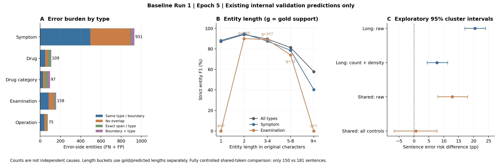

# Baseline Run 1：公开版针对性错误分析

本公开版源于Epoch5真实内部val预测及原始字符Gold的独立分析。最佳严格Micro F1 **89.6837%**，TP5955、FP724、FN646；9687句中814句至少有一个实体错误。完整23例文本、匿名样本ID、原始对话身份、逐句跨度/预测、完整日志及本机绝对路径均不发布；下文只保留聚合结论和概括性错误模式。

## 数据身份、方法与计数单位

实验身份、代码/配置/数据/Checkpoint哈希及五类总体成绩见[正式基准记录](../experiments/baseline_run1.md)和[结构化摘要](../experiments/baseline_run1_summary.json)。全部数据仅来自固定内部val，未调用官方dev/test。预测与原始Gold复合ID、字符长度、BIO及半开跨度`[start,end)`已核对；错误集合与原errors逐句一致。完整原始本地证据索引见基准记录。

TP要求句子身份、边界、类型同时相同；不会用Gold修正预测。以下错误侧桶按每个FN/FP分别互斥，优先级为同边界异类型→同类重叠→异类重叠→无重叠。FN与FP不是根因事件，不能直接相加后声称独立错误原因数量。

| 错误侧桶 | FN | FP |
| --- | --- | --- |
| 同类边界不一致 | 341 | 355 |
| 无重叠对应实体 | 225 | 292 |
| 同边界异类型 | 38 | 38 |
| 异类型且边界重叠不全等 | 42 | 39 |

从未匹配实体构建正长度交集二部图，其连通分量互斥：

| 未匹配实体重叠图分量 | 分量数 | FN | FP |
| --- | --- | --- | --- |
| 孤立漏识别 | 225 | 225 | 0 |
| 一对一同类边界 | 277 | 277 | 277 |
| 一对一纯类型 | 38 | 38 | 38 |
| 孤立误识别 | 292 | 0 | 292 |
| 一对一边界兼类型 | 31 | 31 | 31 |
| 拆分候选 | 32 | 32 | 64 |
| 合并候选 | 20 | 41 | 20 |
| 多对多复杂边界 | 1 | 2 | 2 |

合计916个几何分量，覆盖646FN、724FP和814个错误句。拆分/合并是几何候选，不是已确认的语义根因：32处拆分含28处同类型、4处混合类型；20处合并含14处同类型、6处混合类型。一个实体拆成两个时计1个分量、1FN/2FP，不计三个独立原因。

277对一对一同类边界中：扩张155、缩短119、整体偏移3；起点提前105/后移69/不变103，终点提前59/后移55/不变163。起止方向互有重叠，不能相加为实体数。零Gold句5708，其中133句出现141FP；多Gold句1515，其中279句部分正确而仍有FN，合计贡献335FN（包含边界/类型错误）。

## Medical_Examination和Symptom

Medical_Examination：Gold615、TP537、FP80、FN78，F1 **87.1753%**。同类边界桶43FN/40FP，无重叠21FN/29FP，同边界类型11FN/2FP，其余边界兼类型3FN/9FP。37处一对一同类边界中缩短19、扩张18；并非单向偏长。检查名称和测量描述范围、病原体名称范围、通用检查动作漏识别、器械词片段误触发是本地案例观察到的不同模式，尚不能归因于同一模型机制。

同边界检查→Symptom7对、→Operation3对、→Drug1对；Operation→检查2对。病原体、检查动作及操作的语义层级需按标注规范人工判断，不能据预测不符就认定Gold错。

Symptom：Gold4447、TP4018、FP502、FN429，F1 **89.6175%**。其Gold占67.37%，FP+FN占67.96%，绝对错误数大与支持数大相伴；FN/Gold9.65%、FP/Pred11.11%，均低于检查类对应比例。边界桶238FN/257FP，无重叠170FN/224FP。192对一对一同类边界中扩张104、缩短85、偏移3。

| 类型 | 自身实体长度 | Gold/Pred | TP/FP/FN | P/R/F1 |
| --- | --- | --- | --- | --- |
| Symptom | 1 | 502/516 | 449/67/53 | 87.0155%/89.4422%/88.2122% |
| Medical_Examination | 1 | 0/1 | 0/1/0 | 0.0000%/0.0000%/0.0000% |
| Symptom | 2 | 2362/2357 | 2234/123/128 | 94.7815%/94.5809%/94.6811% |
| Medical_Examination | 2 | 165/157 | 145/12/20 | 92.3567%/87.8788%/90.0621% |
| Symptom | 3-4 | 919/962 | 824/138/95 | 85.6549%/89.6627%/87.6130% |
| Medical_Examination | 3-4 | 377/375 | 335/40/42 | 89.3333%/88.8594%/89.0957% |
| Symptom | 5-8 | 612/638 | 491/147/121 | 76.9592%/80.2288%/78.5600% |
| Medical_Examination | 5-8 | 72/82 | 57/25/15 | 69.5122%/79.1667%/74.0260% |
| Symptom | 9+ | 52/47 | 20/27/32 | 42.5532%/38.4615%/40.4040% |
| Medical_Examination | 9+ | 1/2 | 0/2/1 | 0.0000%/0.0000%/0.0000% |

Gold/FN按金标自身长度归组，Pred/FP按预测自身长度归组，TP长度相同；一次边界改变可让FN和FP落入不同长度桶。较长实体的严格边界较弱：检查5–8字F1 74.03%（Gold72）；Symptom5–8字78.56%（Gold612），9字以上40.40%（Gold52）。检查9字以上只有1Gold、2Pred，不能泛化；检查1字组无Gold，F1=0不表示召回失败。

Symptom5字以上Gold664（本类14.93%），却贡献153FN/174FP（本类错误侧35.12%）。本地23例覆盖限定成分纳入/遗漏、程度字符遗漏、口语事件描述漏识别、重复表达误触发、跨标点拆分、连接词合并、多实体部分识别及相邻药名分界。这里发布概括，不公开原文，也未把所有扩张都强行命名为“修饰语错误”。

## Drug与Drug_Category

同边界两个方向各11对，每方向涉及7种词形，分别有11种和10种完整句上下文。每方向出现最多的三种词形合计7/11，既有重复集中，也有不同词汇和上下文。22个混淆对贡献22FN/22FP，占全部38对同边界类型错误的57.89%；不是44个独立混淆原因。

错误涉及具体制剂、成分泛称、类别简称和药物家族的层级约定。只能确认模型预测不等于金标，可能的标注语义边界须人工核查；未认定Gold错、未改标、未检验训练词频。上述词形频次只描述错误集合，不是词语在全val上的条件错误率。

## 长句、实体机会数、密度与共享Token

[完整聚合CSV](grouped_error_statistics.csv)含204行：各句长、Token长、实体数、实体长度、两种密度、共享Token、数字/英文模式与ALL/五类型交叉统计。无原文、样本ID、逐句标签或坐标。

- 原字符长：1–16、17–32、33–64、65+；Token长含特殊Token：≤32、33–64、65–128、129–256。最大实际155，无截断。
- Gold实体数：0、1、2、3–4、5+。字符覆盖密度为Gold实体字符总数/句长，分0、(0,0.1]、(0.1,0.25]、(0.25,0.5]、(0.5,1]；另报每10字符实体数0、(0,0.5]、(0.5,1]、(1,2]、>2，二者含义不同。
- 句子维度各桶覆盖全val；实体长度维度同句可进入多个桶，句数不能相加。CSV中sentences为同一长度桶任一类型实体的句子子集，分类型表需结合sentences_with_selected_entity、Gold/Pred。any_entity_error_sentence_rate为全句任意错误，entity_error_sentence_rate以涉及指定组实体的句子为分母；不可混用。
- 句数<30或Gold/Pred任一支持<30标为small_group；它是小样本提示，不是显著性检验。零分母P/R/F1按0记录，不能据无Gold桶F1解释召回。

1–16字句有错率4.77%，17–32字16.36%，33–64字26.09%，65+字34.62%；但65+组实体F1 89.97%，并未低于33–64组88.32%。每句Gold数从最短组0.39升至最长组4.21，必须考虑错误机会数。Token129–256仅4句，不能据其高F1作普遍推断。覆盖密度高与每10字实体数高的分组趋势不一致，不支持“密度越高一定越难”。

以下为探索性条件关联：长句定义>32字；共享Token指一个有效offset覆盖多个原字符。直接标准化只保留两组每层各≥5句的共同支持，按共同支持pooled样本数加权；247个对话聚类bootstrap1000次，分析seed20261020，固定支持层/权重，有效次数<800不报区间，未校正多重比较。**这不是因果消融。**

| 比较 | 共同支持句数/全组（参照；暴露） | 风险差/百分点 | 探索性95%区间/百分点 |
| --- | --- | --- | --- |
| 长句，未调整 | 8966/8966；721/721 | +20.44 | [+17.03, +23.99] |
| 长句，精确实体数+密度 | 7515/8966；629/721 | +7.73 | [+4.39, +11.31] |
| 共享Token，未调整 | 9356/9356；331/331 | +12.88 | [+7.94, +17.94] |
| 共享Token，句长+实体数粗分组 | 9279/9356；328/331 | +6.74 | [+2.56, +11.54] |
| 共享Token，再控制数字/英文 | 197/9356；275/331 | +5.03 | [-2.47, +12.08] |
| 共享Token，句长+精确实体数+数字/英文+密度 | 150/9356；181/331 | +0.65 | [-6.64, +7.71] |

控制精确实体数和密度后，长句风险差仍7.73个百分点；共同支持覆盖短句83.82%、长句87.24%。实体类型、词汇和语义复杂度未完全控制，不能直接归因于BERT长序列能力或CRF。

331句含共享Token，385个Token覆盖807字符，其中359个纯数字（93.25%），纯ASCII字母21、字母数字混合3、其他2；数字/英文是明显混杂。完全控制后风险差0.65个百分点、区间跨0，但只覆盖非共享150/9356（1.60%）和共享181/331（54.68%），**不能据此宣称没有表示影响**，也不能由未调整差异认定映射有缺陷。

直接与共享跨度相交的错误侧实体为36FN/41FP，占总1370的5.62%；其余94.38%不直接相交。Gold边界切入共享Token的2个实体来自同一句原有歧义样本；预测侧另有2个内部边界实体。局部数值串存在共享表示下区分相邻字符边界的困难案例，但每个原字符仍唯一覆盖，gap/overlap/非法offset均0。**当前没有发现可复现的offset_share_unique_v1实现错配**；没有依据改映射、截断句子或修Gold。

## 下一步与解释边界

23例在本地按错误类型槽确定性抽取，兼顾候选池中位句长、重复/不同词形和稀有结构；不是随机流行率样本。跨度/类型为直接事实，局部语义为描述性解释，训练覆盖、泛化与模型机制为待验证假设；医学语义和标注规范需人工判断。预选案例槽一次“shift”名称实际涵盖双端扩张，最终报告已更正名称并保留原候选，边界统计未受影响。

最合理的下一步是先复核检查范围、症状限定/程度成分、跨标点和并列实体分隔、检查/症状/操作与药物类别层级，不擅自改数据或标签。之后若比较口径没有实质性阻塞，可仅改变输出头Dropout **0.1→0.2**；它位于字符表示至Linear前，不会自动改变BERT内部Dropout。

该正则化可能改善部分词汇触发或泛化，也可能损害长实体召回；Val NLL上升而严格F1仍提高不能证明其有效。后续对照保持学习率、固定划分、原字符Gold、映射、最多5轮/早停、Batch16、seed42、精度、调度与其他条件不变，观察最佳严格F1、五类P/R、长实体召回及边界/纯误识别变化。仅NLL降低不足以宣称任务改善，单种子微小差值不能证明稳定收益。

本公开版不包含全部案例或完整分析日志。相应原件继续保存在本地受控证据目录；发布哈希只建立来源身份，不是隐私保障。没有启动Dropout实验、改配置或生成新预测。
