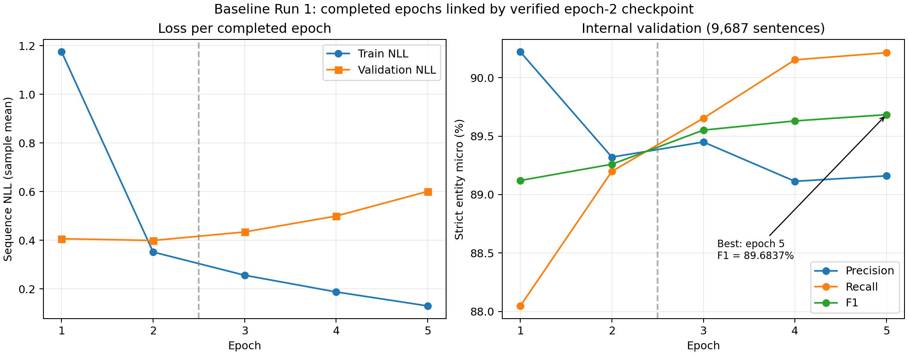

# Baseline Run 1：字符级BERT-CRF正式基准

这是适合GitHub归档的统计报告，来源于已完成的独立审计与针对性错误分析。完整本地证据不移动、不覆盖；原文、逐句预测/错误、Checkpoint及敏感日志不发布。本次归档未重新训练、推理或改动正式配置。

## 任务、模型与数据

任务为IMCS-V2-NER（IMCS21-CBLUE）Task1中文医疗命名实体识别。模型为BERT→`offset_share_unique_v1`字符表示映射→输出头Dropout(0.1)→Linear→带严格BIO转移约束的CRF。监督直接使用原始字符BIO，不使用有损Token级标签。输出与原始文本字符等长，保留原句身份及顺序；GitHub不包含逐句输出。

内部train：2225对话、88842句、1153312字符；内部val：247对话、9687句、126049字符、6601个Gold实体。两者按固定对话划分互斥，均来自官方train；官方dev/test未用于本次调参、选模或额外预测。

- 数据版本：`IMCS-V2-NER_train_sha256_07cdd379`，原始官方train文件SHA-256：`07cdd3799087283a5a17de8bb43e71cb159a9a2c99c1cfbe8081847fac358f24`。
- 划分版本：`split_v1_sha256_497f21cf`，固定划分文件SHA-256：`497f21cf13d8f5accb83f86ffda16a4a59ba716c064ec347e990a219e8957072`。
- 训练代码：提交`a955f56855f72c944010b93c9965c01187c15b4d`，分支`dxc`。训练源码、配置和测试已在该提交中；本次只新增归档文档和统计图表。
- [正式配置](../../../configs/bert_crf/first_baseline.json)保持原样。运行记录的Windows工作文件SHA-256为`2bf995dc16e85060e25805862ccf8227f6dff6b2ee390070e98b276dd503389d`；Git中对应文件内容SHA-256为`f8a74c08a8b99e704710f13694389c1c925c63ba1c862d269d4730cbe321aa88`。两者只有CRLF/LF字节差异，JSON内容与两段实际运行一致，不能把换行差异误认成改参。

哈希用于身份/完整性核验，不是匿名化或数据安全保证。完整精度和机器可读信息见[归档摘要](baseline_run1_summary.json)。

## 实际正式配置

| 条件 | 实际值 |
| --- | --- |
| 预训练模型/Tokenizer | google-bert/bert-base-chinese；固定revision 8f23c25b06e129b6c986331a13d8d025a92cf0ea |
| 优化器/初始学习率 | AdamW；BERT、Linear、CRF均2e-5 |
| 训练预算/早停 | 最多5 Epoch；patience=2；本次完成5轮，未触发早停 |
| Batch / 累积 / workers | 16 / 1 / 0；每轮5553步，最后一批10句 |
| 调度/预热 | Linear；warmup ratio 0.1，实际2777步，总计划27765步 |
| 正则化 | Weight decay 0.01；梯度裁剪1.0；输出头Dropout 0.1 |
| AdamW数值配置 | betas=(0.9,0.999)，epsilon=1e-8 |
| 随机性/精度 | seed42；FP32，无AMP；确定性算法启用，TF32关闭 |
| 长度策略 | 动态最长Padding；max_tokens=256；拒绝静默截断、offset缺口与重叠 |
| 监督/映射 | 原始字符BIO；offset_share_unique_v1；Python Unicode码点与[start,end) |
| 选模 | 内部val严格实体级Micro F1最大；平分保留较早Epoch；不以val NLL选模 |

运行环境：Windows 11，Python3.13.5，PyTorch2.14.1+cu132，Transformers5.20.1，tokenizers0.23.3，NumPy2.4.6，CUDA13.2，RTX5060 Laptop GPU。权重与Tokenizer按配置的固定revision及文件哈希定位；本报告不包含权重或本机绝对路径。

## 中止与恢复：两段运行组成同一基准

| 项目 | 原运行 | 恢复运行 |
| --- | --- | --- |
| 实验ID | `20261020T185424+0800_real_training_71838655` | `20261020T215116+0800_real_training_76608cc3` |
| 状态 | interrupted | completed |
| 完整Epoch | 1–2 | 3–5 |
| manifest开始时间（+08:00） | 2026-10-20 18:54:24.958660 | 2026-10-20 21:51:16.974779 |
| 停止/完成时间（+08:00） | 2026-10-20 19:47:31.197223 | 2026-10-20 22:47:42.620109 |

原运行在Epoch3中途强制停止；不是无损停止到当时batch。保留并核验Epoch2 Checkpoint（SHA-256 `db221c3cc04e8870d33abef069944d9d9e0488c6d3016862f6daf44ebd359138`），从epoch=2/global_step=11106恢复模型、AdamW、scheduler、随机状态、最佳指标和早停状态；新运行第一步global_step=11107，重跑Epoch3，最终到27765。两段history分别保留，不覆盖原中止记录；原运行根目录最终predictions/errors尚未生成，但完整Epoch1–2的验证产物存在且已审计。

最终模型沿袭的更新次数为**27765**；原Epoch3已记录的1603次部分更新未进入恢复后的模型。两次调用合计记录29368次更新，但强停可能发生在更新与日志之间，因此实际物理更新总数只能说**至少29368，精确值未保存**。不能把全部计算开销写成27765步。

恢复运行逻辑完成由完成标记、训练结束日志、5轮历史、Checkpoint和验证输出交叉支持；后台最终OS数字退出码未持久化，不能补写exit=0。此次未触发Early Stopping，不把进程退出直接作为完成证据。

## Epoch1–5真实结果

| Epoch | 来源 | Train NLL | Val NLL | 严格实体 P | 严格实体 R | 严格实体 F1 | 轮末LR | 轮耗时/s | 累计保留更新 |
| --- | --- | --- | --- | --- | --- | --- | --- | --- | --- |
| 1 | 原运行 | 1.174061134 | 0.406409793 | 90.2204% | 88.0473% | 89.1206% | 1.77781335e-05 | 1398.801 | 5553 |
| 2 | 原运行 | 0.351774214 | 0.399234808 | 89.3204% | 89.1986% | 89.2595% | 1.333360013e-05 | 1393.753 | 11106 |
| 3 | 恢复运行 | 0.256392796 | 0.434227838 | 89.4498% | 89.6531% | 89.5513% | 8.889066752e-06 | 1182.081 | 16659 |
| 4 | 恢复运行 | 0.187812275 | 0.499640129 | 89.1135% | 90.1530% | 89.6302% | 4.444533376e-06 | 1097.333 | 22212 |
| 5 | 恢复运行 | 0.130306166 | 0.600811889 | 89.1601% | 90.2136% | 89.6837% | 0 | 1102.328 | 27765 |

NLL为样本平均的字符序列CRF负对数似然，Train NLL按batch样本数加权；不是逐Token交叉熵。表中LR为轮末值，最终0来自线性调度，不代表初始学习率为0。每轮均有严格F1改进，因此最佳为Epoch5。

完整Epoch耗时累计**6174.296791秒（102.905分钟）**；包含暂停的首启至结束墙钟为13997.661449秒。原段无完整fit总计时，混合计时边界得到的活跃时间估计为6570.952568秒，不能当成精确GPU训练时长。所有口径分别保留于摘要。

Train NLL持续下降，Val NLL在Epoch2最低后升高，严格F1仍缓慢提高；这是需要检查泛化/置信度的迹象，不能直接证明已充分收敛、Dropout必然有效或某个超参数有因果问题。

## 最佳Epoch5严格实体结果

总体：**P89.1601%、R90.2136%、F1 89.6837%，TP5955、FP724、FN646**，Gold6601、Pred6679。实体必须在同一句、起止边界和类型均完全相同；跨度为Python码点半开区间`[start,end)`，Micro零分母取0。

| 实体类型 | Gold | Pred | TP | FP | FN | Precision | Recall | F1 |
| --- | --- | --- | --- | --- | --- | --- | --- | --- |
| Symptom | 4447 | 4520 | 4018 | 502 | 429 | 88.8938% | 90.3530% | 89.6175% |
| Drug | 725 | 722 | 669 | 53 | 56 | 92.6593% | 92.2759% | 92.4672% |
| Drug_Category | 490 | 491 | 442 | 49 | 48 | 90.0204% | 90.2041% | 90.1121% |
| Medical_Examination | 615 | 617 | 537 | 80 | 78 | 87.0340% | 87.3171% | 87.1753% |
| Operation | 324 | 329 | 289 | 40 | 35 | 87.8419% | 89.1975% | 88.5145% |

最佳Checkpoint在本地`experiments/bert_crf/20261020T215116+0800_real_training_76608cc3/checkpoints/epoch_0005.pt`，大小1220509451字节，SHA-256 `220b237d3f6e545a8b86459adccb38c16e0c79cc9f541dc5f975c3bfe321b9e9`；文件不上传。按val严格实体Micro F1选择、平分保留较早轮，不能改用最低Val NLL的Epoch2作为已报告最佳。

## 独立核验与证据边界

已有独立审计逐Epoch用固定val原始字符Gold和保存预测重算严格指标、逐句核对errors、检查复合ID/长度/BIO、交叉比对CSV/日志/结构化指标、核验5个Checkpoint及恢复状态。最佳模型47条内部val样本重新推理与保存预测逐字符一致，去除Gold后解码仍一致。**这是47条抽样推理核验，不是完整val重新推理。** 审计曾有一次JSON序列化失败，修正后完成，失败证据仍在本地；不影响原训练记录。

本次归档再核对两段source_manifest、正式配置、文件哈希、公开表格和聚合CSV，引用的是已经执行的审计结果；没有在归档时重复模型加载或推理。

| 本地受控证据索引（不在GitHub发布） | 用途 |
| --- | --- |
| `docs/bert_crf/evidence/20261020T230513+0800_baseline_run1_audit/` | 原审计报告、逐Epoch核算、Checkpoint/恢复核验、原始清单与命令 |
| `docs/bert_crf/evidence/20261020T234238+0800_baseline_error_analysis/` | 原错误分析、23例必要短片段、分组/条件分析、命令与完整输入清单 |
| `experiments/bert_crf/`内上述两段实验目录 | 完整配置、环境、历史、日志、内部val预测、错误与权重 |

以上为本地证据位置说明，不是GitHub可下载链接。公开版[错误分析](../analysis/baseline_run1_error_analysis.md)只保留聚合统计、方法和谨慎结论，不公开23例原始文本或样本ID。

## 限制与下一步

这是单种子首次基准，没有超参数对照、跨种子方差或官方测试集成绩。BERT-CRF使用原字符Gold；BERT-Softmax的具体监督粒度仍须按团队实际实现核实，如粒度不同，方法间性能差异不能全部归因于CRF。

当前未发现可复现的字符映射实现错配。下一步先人工复核实体范围与类别约定，不自行改标签；之后视情况仅将**输出头Dropout0.1→0.2**作为单因素实验，其余配置和选模规则保持一致。该收益尚未验证，本次没有启动实验。

后续每次实验必须创建独立运行目录，保存实际配置、代码版本、环境、日志、历史、预测、指标、Checkpoint身份和必要哈希，分别记录中止/恢复事件，不覆盖旧运行。数据、固定划分、预训练权重和Checkpoint未公开；**他人不能只凭GitHub文档完整复现训练**，需要获得合规数据访问及匹配版本的本地资源。
