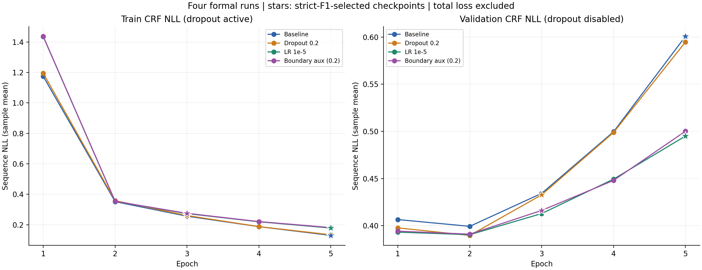
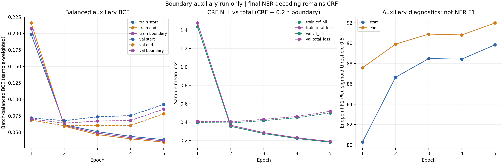

# 第四轮 Boundary Auxiliary：独立结果审计

第四轮审计通过，完成5个Epoch及27765次更新，退出码0；最佳为E3。严格实体Micro F1 **89.9380%**，比第三轮**−0.0522 pp**。辅助头与联合损失实际生效，但现有结果不足以支持替换第三轮主候选。

[四轮完整JSON](../analysis/four_runs_comparison.json) · [全部标量CSV](../analysis/four_runs_comparison.csv) · [第四轮摘要](boundary_aux_summary.json) · [实际正式配置](../../../configs/bert_crf/boundary_aux_02.json) · [四轮分析报告](four_runs_comparison.md)

## 运行身份、完成状态与时长

- 唯一正式run：`20261021T231741+0800_real_training_86767c7e`，本地目录`experiments/bert_crf/20261021T231741+0800_real_training_86767c7e`。通过配置、manifest、启动与退出记录、Checkpoint、预测及源码哈希联合定位，不按目录名认定。
- 原配置字节SHA-256：`c0354da4afeb96bac0b5c1bcf0cb996d4f609219c093ce370fa520df613699ba`；formal identity：`7a8080efe843bfb9ebcc4f44f0719d3c0dd9fb0d1a5425b3ed6e2f356696aee8`；模型identity：`d62bffea89dc039f23d134d2438df55eb6e437b9dde38fe32ab885589ef0b9f2`。
- 训练时Git HEAD：`1bc62ab2638d0cfeb0a618f7a22ab249491478ec`，分支dxc，存在本轮7份修改及3份新文件。训练目录保存完整源码快照、manifest和Patch；本次待发布的10份文件均与**实际训练快照逐字节相同**，没有拿训练后修复冒充训练版本。
- 工作目录为项目根目录。历史命令：`.venv-bert-crf/Scripts/pythonw.exe -u -X utf8 scripts/train_bert_crf.py --config configs/bert_crf/boundary_aux_02.json --train --preflight-output .local/bert_crf/20261021T224813+0800_boundary_aux_launch/preflight_training`。本次没有执行该训练命令。
- worker启动：2026-10-21T23:16:42.971947+08:00；run建立：2026-10-21T23:17:41.137934+08:00；逻辑结束：2026-10-22T00:54:11.868749+08:00；监督器确认退出：2026-10-22T00:54:13.215982+08:00。以上时区均+08:00。
- 最终`early_stopped`：E3最佳，E4/E5未刷新，bad_epochs=2、patience2在E5末触发，同时完成最大5轮。不是未完成。只有一次formal_training_started、resume_from=null，日志无恢复/失败事件，监督器exit0、automatic_restarts0。
- 每轮ceil(88842/16)=5553次更新，末Batch10句；实际日志global_step连续1–27765，与Checkpoint、history和state一致。Warmup2777、Linear总计划27765；一个AdamW参数组包含206个参数张量，新旧各模块基准LR统一1e-5，FP32/无AMP，累积1。
- fit **5789.781278500秒**（含更新、验证、日志与Checkpoint I/O，不含初始模型/Provider加载）；完整Epoch时间和5789.733396700秒；worker启动至退出5850.244035秒。实际训练峰值allocated=3905309696、reserved=4752146432 bytes。未记录持续利用率曲线，不补造。

## 实际实现与对照有效性

保留同一google-bert/bert-base-chinese revision `8f23c25b06e129b6c986331a13d8d025a92cf0ea`，原字符BIO、offset_share_unique_v1、Linear标签空间、严格BIO约束CRF、Viterbi和指标实现。字符隐藏表示在主头Dropout之前分流到两个Linear(768,1)，无额外Dropout，BERT不重复执行。主模型101685658参数，增加1538，共101687196；新增start/end weight各[1,768]、bias各[1]。

辅助标签由原`metrics.entities`解析半开跨度[start,end)，在start及end−1置1；不含CLS/SEP/Padding。每个Gold实体恰好一个起点/终点，包括单字符和同类相邻实体；全O有效字符全0。没有新标注、伪实体或Gold修正解码。

每个Batch仅在有效原字符上计算BCEWithLogits，不先Sigmoid；每个任务将正例平均BCE与负例平均BCE等权平均，缺某一类时仅取存在类。`boundary=(start+end)/2`，`total=CRF NLL+0.2×boundary`。CRF reduction=mean是样本级序列NLL。训练器反传output.loss=total；train_loss/val_loss仍为CRF NLL。Epoch辅助Loss是以样本数加权的Batch平衡BCE均值，**不是把全部验证字符汇总后重新平衡的BCE**；分批方式因此是口径的一部分。

配置相对第三轮仅有5条结构差异：experiment_name、model.schema_version、model.boundary_aux、resources.measurement_file及measurement_sha256。后两项为新结构真实资源证据，前两项为身份元数据。training、inputs、data、alignment及其他资源预算逐字段相同。保持Batch16、5轮、seed42、weight decay.01、betas(.9,.999)、eps1e-8、clip1、shuffle、2777预热及原Micro F1选模。辅助头在独立CPU RNG作用域初始化；启动实测主路径初始哈希及CPU/CUDA RNG与第三轮初始模型一致，未从第三轮微调Checkpoint继续训练。

这是**第三轮→第四轮边界辅助训练方法对照**，包含所需模型版本、日志与资源接入；不是与Dropout第二轮的单变量对照，也不证明观察差异全部由辅助监督导致。

## 训练和辅助Loss的真实曲线

| E | Train CRF NLL | Val CRF NLL | P% | R% | F1% | 轮末LR | 秒 | 累计更新 | 最佳 |
| --- | --- | --- | --- | --- | --- | --- | --- | --- | --- |
| 1 | 1.436718530 | 0.394131693 | 89.4442 | 89.4713 | 89.4577 | 8.88906675204e-06 | 1239.185 | 5553 | 否 |
| 2 | 0.354031474 | 0.390951348 | 89.6385 | 89.7743 | 89.7063 | 6.66680006403e-06 | 1139.003 | 11106 | 否 |
| 3 | 0.275384900 | 0.416118138 | 89.8292 | 90.0470 | 89.9380 | 4.44453337602e-06 | 1140.123 | 16659 | 是 |
| 4 | 0.221038041 | 0.447926464 | 89.0161 | 90.7287 | 89.8642 | 2.22226668801e-06 | 1137.480 | 22212 | 否 |
| 5 | 0.181764512 | 0.500163627 | 89.3627 | 90.4863 | 89.9210 | 0 | 1133.942 | 27765 | 否 |

| E | Train Start | Train End | Train Boundary | Train Total | Val Start | Val End | Val Boundary | Val Total |
| --- | --- | --- | --- | --- | --- | --- | --- | --- |
| 1 | 0.198742466 | 0.215963051 | 0.207352758 | 1.478189083 | 0.071600588 | 0.068258955 | 0.069929772 | 0.408117649 |
| 2 | 0.061288981 | 0.059044895 | 0.060166938 | 0.366064861 | 0.067510753 | 0.059923118 | 0.063716935 | 0.403694734 |
| 3 | 0.050831651 | 0.046344573 | 0.048588112 | 0.285102522 | 0.073333828 | 0.060482715 | 0.066908272 | 0.429499792 |
| 4 | 0.043614225 | 0.039889060 | 0.041751642 | 0.229388369 | 0.075196759 | 0.060188316 | 0.067692537 | 0.461464971 |
| 5 | 0.038641245 | 0.034838689 | 0.036739967 | 0.189112505 | 0.092178373 | 0.078053368 | 0.085115871 | 0.517186802 |

Train CRF从1.4367降至0.1818，Train Boundary从0.20735降至0.03674；Val CRF最低在E2=0.390951348，最佳严格F1在E3（CRF=0.416118138），最低NLL不能替代既定F1选模。Val CRF E2→E5上升0.109212279，Val Boundary从E2的0.063716935升至E5的0.085115871，说明训练/验证分化仍在。与第三轮同Epoch末值比较接近，未解决后期验证NLL上升，不能把第四轮Total与旧轮CRF NLL混画成可比损失。

## 独立指标、数据完整性与Checkpoint

固定内部val来自官方train：247对话、9687句、126049个原始Python Unicode字符、6601实体。复合ID唯一且覆盖固定全集；Gold/预测等长、BIO合法、跨度有效，未发现重复/缺失/静默截断。原始文件与固定划分及Tokenizer哈希均匹配。四轮全部20份逐Epoch预测已独立复算严格实体、固定五类Macro和字符指标；逐句错误的FN/FP集合与原errors完全一致，前三轮公开统计原样复现。

第四轮最佳TP/FP/FN=**5944/673/657**；P=89.8292%，R=90.0470%，MicroF1=89.9380%，MacroF1=89.5896%。字符级精确BIO标签（排O）P/R/F1=90.8061/91.6368/91.2196%；它不是实体F1。

| 实体 | Gold | 第四轮TP/FP/FN | 第四轮−第三轮TP/FP/FN |
| --- | --- | --- | --- |
| Symptom | 4447 | 4012/452/435 | -24/-25/+24 |
| Drug | 725 | 667/55/58 | +0/+2/+0 |
| Drug_Category | 490 | 441/47/49 | -1/+2/+1 |
| Medical_Examination | 615 | 534/77/81 | -2/-10/+2 |
| Operation | 324 | 290/42/34 | -3/+2/+3 |

| E | Checkpoint(本地，不上传) | SHA-256 |
| --- | --- | --- |
| 1 | checkpoints/epoch_0001.pt | 6e93726576e0cd59d2dc02dd23160dc9a3e47cc471f2b82b4cb76b395898deb4 |
| 2 | checkpoints/epoch_0002.pt | e91ac0d9a2f1a963b7c64cc5e78568c63c4a2544b6b2a344c7a08b4bd88ca32f |
| 3 | checkpoints/epoch_0003.pt | e06bae70f7030dd21237578df6e68d9d2f225c1d54781edec326ee196c94a307 |
| 4 | checkpoints/epoch_0004.pt | c162410cf43a78a20c9b1d3853e364d220b384cd210c2b8e42a9823e5cdfbfa0 |
| 5 | checkpoints/epoch_0005.pt | d8d81f61cbbfc78a969334d084c014dcd2a3e2af0d5a8cd3380cfad1042a13d7 |

五份Checkpoint均以原identity检查入口只读加载，模型全部浮点张量有限，206份AdamW state步数与各Epoch累计步数完全一致，Scheduler/RNG齐全。Start/End四份参数均存在，Adam一阶/二阶矩有限且非零，并在每对连续Epoch发生真实参数变化。最佳SHA与manifest、checkpoint_info、日志一致；顶层metrics/predictions/errors是E3最佳副本，最新E5不是最佳。

本次对最佳E3重新加载并**完整推理9687句**，606个Batch逐字符预测全部一致；CRF、Start、End、Boundary、Total Loss和辅助端点指标均精确复现。编码器hook实际606次，确认每Batch一次BERT。另按“首16句+最长16句+首16个错误句”去重取47句，移除Gold后预测一致。全程torch.inference_mode，无优化器构造或更新，参数哈希/版本不变、grad为空。其他Epoch的NLL为记录交叉核验，并未重新执行五套全val前向。

Checkpoint内部最佳自身SHA为null是保存时尚不能自哈希的设计；外部日志/manifest在落盘后记录完整SHA，已核验，不视为损坏。旧真实第三轮Checkpoint按旧identity加载通过，新旧identity互相拒绝；当前267项测试（原239+新增28）全部通过、无跳过，覆盖CPU/CUDA连续与恢复的模型/辅助头/AdamW/Scheduler/RNG/计数一致。恢复测试是隔离微型合成模型，不是新正式训练。

## 辅助任务是否确实参与训练

**已核验支持链**：源码只有一次BERT调用→字符辅助前向→Total Loss→Trainer.loss.backward；AdamW(model.parameters())包含四份辅助参数；27765条训练日志的total、boundary关系逐条有限且吻合；所有五份Checkpoint有辅助参数、有效Adam矩与正确步数，辅助权重跨Epoch变化。测试还验证Padding梯度为0、无正例/负例不会除零、辅助损失未detach、Gold-free及改辅助Logit不会改变CRF预测。

**真实梯度探针**：启动前普通Batch加权辅助/CRF范数比：共享字符0.0129582904、BERT词嵌入0.0118001177；最长Batch分别0.0008249629、0.0004031134。均非零有限，说明λ=.2不等于20%梯度贡献，长Batch初始贡献偏弱。正式日志保存总梯度范数，没有逐步分任务/命名模块梯度，因此不声称已证明每个训练步骤的辅助贡献比例，也不能从这些初始探针推导整个训练的平均贡献。

各Epoch辅助诊断（固定sigmoid阈值0.5，仅有效原始字符，类别无关，每个任务Gold分母6601；不参与选模）：

| E | Start P/R/F1 % | End P/R/F1 % |
| --- | --- | --- |
| 1 | 67.9987/97.9549/80.2731 | 79.7809/97.0762/87.5829 |
| 2 | 78.0408/97.3943/86.6500 | 83.5567/97.3034/89.9076 |
| 3 | 81.3389/97.0005/88.4820 | 85.3250/97.2428/90.8949 |
| 4 | 81.3510/96.8793/88.4387 | 85.0622/97.3943/90.8115 |
| 5 | 84.2916/96.1672/89.8387 | 87.6509/96.7732/91.9865 |

E3起点TP6403/预测7872/Gold6601，终点TP6419/预测7523/Gold6601。E3诊断已完整重推理复现；其他Epoch来自实际保存runtime汇总，未额外读取逐句辅助logits（训练未保存）。辅助F1持续改善也没有带来最终CRF严格F1的单调改善。

## Preflight、失败过程与发布范围

真实资源证据`docs/bert_crf/evidence/20261021T224813+0800_boundary_aux_launch/resource_measurements_v2.json`，SHA `7327b6d3d8d58ad4c8598e9dd091b9d47f4c2b4271a5ff3ada631dba810c7206`，模型、输入、训练/资源配置和实现哈希绑定。最长Batch[16,201]真实前后向，allocated3961390592/reserved4181721088 bytes，无OOM；资源与两个正式Preflight均零更新、参数哈希/版本不变，最终PASS。这里复核原证据，不重新训练。

启动阶段保留两次测试环境setup错误（公共interface路径及原数据/Tokenizer环境变量未设置），以及一次新资源契约tuple/list表示不一致导致的Preflight拒绝；修复仅统一JSON表示，增测后真实重测v2资源和Preflight，未改实验设计或放宽约束。本次审计首次清单脚本误要求中断Baseline根目录errors，exit1；按已知恢复链改为只列存在根文件并保留完整Epoch1–2验证，之后通过。另有命令转义/只读展示字段假定错误，均为审计工具失败，不改变训练或数值，记录在本地过程证据。

| 发布源码/配置/测试 | 训练时文件SHA-256 |
| --- | --- |
| src/bert_crf/config.py | 00e5862661a6b2aed4dda228030edf7e8ff5135b21ce1064bea6a1d74c1b294f |
| src/bert_crf/experiment.py | f9716366a7533869509a13942f6ff546487453e16812136c6ad1ba73129fae86 |
| src/bert_crf/formal_config.py | 4707973a3ff2d9a9d0d719ef21ce9cf3ffdc9326f8f958b0c3b76ee5e5f39e57 |
| src/bert_crf/model.py | 6c180758cf95a58ba15de86cd58c86c69faecffa3c853ba98caf1619f1bd0c2e |
| src/bert_crf/preflight.py | b23168230400c2ab291611088eb07d00f686f890c0a6db260769731454273ef2 |
| src/bert_crf/run_artifacts.py | 8b41cb38875fb3133c6e3898ba64d912ddffe8cf313ce3a01c68a0442c796828 |
| src/bert_crf/trainer.py | 81af2cdadd54634593f7462b1707001c6d02e163b60d35be8d48f7e604598f8a |
| src/bert_crf/boundary.py | b597976055e5b09ee1c6ac017d936ea347bb8ee9befd24de21cc819718f1746c |
| tests/bert_crf/test_boundary_aux.py | 27b857584778b74ae9792ca79f9a9cdd012f556246182ec95e62434de2964b46 |
| configs/bert_crf/boundary_aux_02.json | c0354da4afeb96bac0b5c1bcf0cb996d4f609219c093ce370fa520df613699ba |

公开配置与实际训练文件字节一致，不含本机绝对路径，无需脱敏；相对`.local/`资源未公开。公开源码即上述快照版本，本次未修改训练逻辑。原始医疗文本、逐句预测/错误/匿名案例ID、Checkpoint/优化器/RNG、完整日志与预训练权重仅本地受控保存。审计与发布证据本地：`docs/bert_crf/evidence/20261022T200005+0800_boundary_aux_result_audit`，启动证据`docs/bert_crf/evidence/20261021T224813+0800_boundary_aux_launch`；不是GitHub下载链接。

## 结论边界

已验证事实：训练完整、辅助机制生效、E3最好、相对第三轮F1略低，五份Checkpoint可用、源码可追溯。数据支持观察：更少FP伴随更多FN，部分边界/长组改善，但不全面，详见四轮报告。未证实：跨seed稳定收益、官方测试集推广、所有边界变化的因果机制。单seed42、同一内部val反复选模与试验、探索性Bootstrap限制仍在。当前没有阻止如实归档的实验有效性问题；**科学上未证明更优与工程上审计通过是两个不同结论**。
