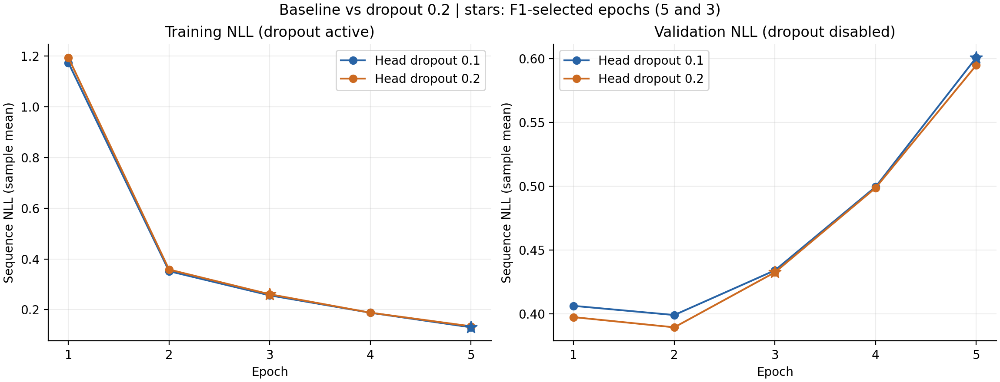
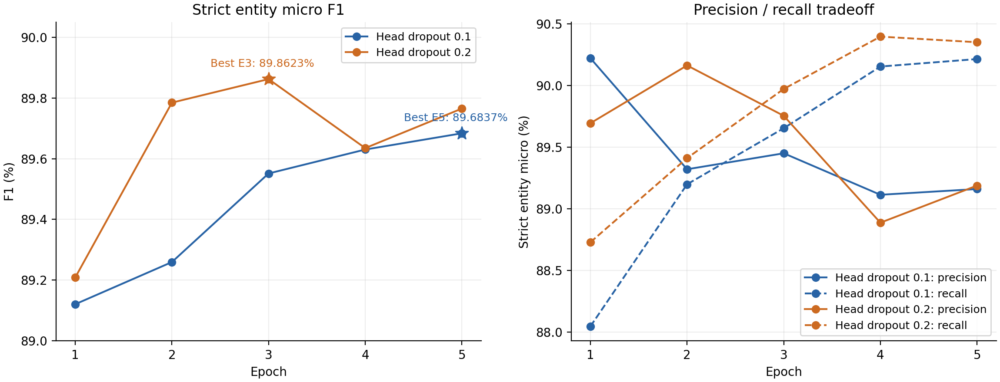
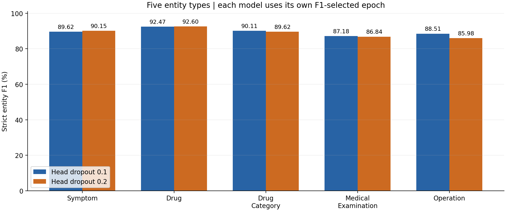
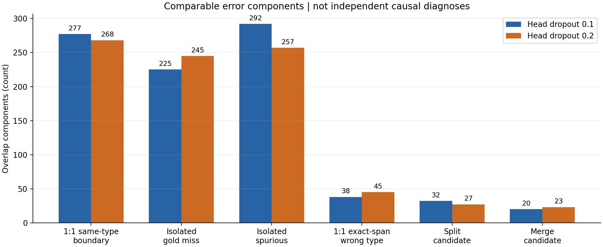

# BERT-CRF 第二轮 Dropout 0.2 实验与 Baseline 完整对照

本报告由已通过审计的本地完整报告整理为公开版，保留数值、统计方法、改善与恶化、局限和建议。仅删除医疗文本/案例身份、机器绝对路径和本地逐文件日志索引；未重训、重推理或重新选取样本。文中“本轮审计”指已经完成的结果审计过程。

- [真实正式配置](../../../configs/bert_crf/dropout_02.json) · [完整结构化摘要](dropout02_summary.json) · [完整数值对比数据](../analysis/dropout02_comparison_data.json)
- 百分比差值统一使用百分点（pp），Delta=Dropout0.2−Baseline；JSON的P/R/F1为0–1比例。
- 文中未提供超链接的`*.json`/日志/Checkpoint路径是本地证据索引，不是GitHub下载链接。实际历史命令采用项目相对路径展示；外部机器需自行准备未公开的受控数据、固定划分与模型资源。

## 一、执行摘要

第二轮真实正式运行 **正常结束，操作系统退出码 0，完成全部 5 个 Epoch、27,765 次优化器更新**。最终逻辑状态为 `early_stopped`：Epoch 3 最佳，Epoch 4、5 连续未刷新，patience=2 在 Epoch 5 末触发，同时达到最大 Epoch=5；这不表示少跑了训练轮数。

最佳为 **Epoch 3**，严格实体级 Micro Precision **89.7537%**、Recall **89.9712%**、F1 **89.8623%**，TP/FP/FN=5939/678/662。相对 Baseline Epoch 5，F1 **+0.1786 pp**，Precision +0.5936 pp，Recall -0.2424 pp；TP −16、FP −46、FN +16。因此收益主要来自误报减少，未获得总体召回提升。

训练器 `fit` 耗时 **5490.146387 秒（91.5024 分钟）**；启动至进程退出 5545.937463 秒。两轮实际仅一个训练变量不同：输出头 Dropout 0.1→0.2，另两处为资源证据路径和哈希；36 份共有源码身份一致，BERT 内部 Dropout 仍为 0.1。

两轮全部 10 份逐 Epoch 预测独立复算，实体/字符指标与原记录逐字段完全一致；最佳模型 47 句抽样重推理一致，五份 Checkpoint 均可读。Symptom、Drug 改善；Drug_Category、Medical_Examination、Operation 恶化，Macro F1 下降 0.5427 pp。验证 NLL 后期上升仍存在，且 E2→E5 上升幅度没有减小。

**结论：保留 Dropout 0.2 / Epoch 3 作为当前内部 val Micro F1 最高候选，同时保留 Baseline；证据不足以全面替换 Baseline 或宣称稳定改进。** 对话级 Bootstrap 的探索性 95% 百分位区间为 [-0.2628, +0.6370] pp，跨 0；单种子及选模后的内部验证结果仍有不确定性。

关键来源：`record_cross_checks.json`、`independent_recalculation.json`、`paired_prediction_analysis.json`、`config_diff.json`；以下各章给出具体输入及口径。

## 二、实验身份与完整性

### 2.1 唯一正式运行与状态


| 字段 | 核实结果 |
| --- | --- |
| 正式 run_id | 20261021T004808+0800_real_training_8aad7b72 |
| 目录 | `experiments/bert_crf/20261021T004808+0800_real_training_8aad7b72` |
| 正式配置 | `configs/bert_crf/dropout_02.json` |
| 正式配置 SHA-256 | 2420b6c583df0d2da5efdf22ff571d647da335bccb07fc1c94890cc7a7edf726 |
| 运行 config.json SHA-256 | bc91cc75553046e81ff822e42a7625f4af4c2c4cc1ffcf93fa4d2a086999c011 |
| Git commit / 分支 | 7c9b4d7e45398de445e019772fc8e690aa3099e8 / dxc |
| 当时及本轮工作区 | ?? configs/bert_crf/dropout_02.json（已有未跟踪配置；无 tracked 修改） |
| 工作目录 | `.` |
| worker 启动时间 | 2026-10-21T00:47:15.146681+08:00 |
| 正式 run 建立时间 | 2026-10-21T00:48:08.587331+08:00 |
| manifest 结束时间 | 2026-10-21T02:19:39.738284+08:00 |
| supervisor 确认退出时间 | 2026-10-21T02:19:41.084144+08:00 |
| 历史 worker / launcher / supervisor PID | 29972 / 6672 / 24728 |
| 实际最终状态 | early_stopped；完成 5/5 Epoch；exit_code=0 |
| 中断、恢复及自动重试 | 正式运行无；run.log 只有一次 formal_training_started，resume_from=null，首个 global_step=1 |
| 本轮一次进程快照 | 未发现 python/pythonw；不据此单独判断成功，结合 manifest、history、日志、退出记录和 Checkpoint |


实际历史启动命令（仅记录，**本轮未执行**）：

```text
python scripts/train_bert_crf.py --config configs/bert_crf/dropout_02.json --train --preflight-output <local-preflight-evidence-directory>
```

运行名中的 `experiment_name` 实际仍为 `first_baseline`，并未改名；本轮使用 run_id、配置哈希、resource/launch 记录和 manifest 共同定位，不按名称猜测身份。顶层 `metrics.json`、`predictions.jsonl`、`errors.jsonl` 对应最佳 E3，并与 `validation/epoch_0003/` 文件哈希一致；最新 Checkpoint 是 E5，不能将最新误当最佳。

### 2.2 历史阻塞、资源补证和 Preflight

保留的初次失败目录：`.local/bert_crf/20261021T003239+0800_dropout_02_launch`。`blocked_summary.json` 记录 exit=1，原因 `Resource evidence model/input configuration mismatch`；Dropout 0.2 配置误引用 0.1 的资源证据，**未启动训练、optimizer_steps=0**，预留 run_id 未形成正式运行。本轮不将其视为第二次训练或任何成绩。

之后独立补证目录：`.local/bert_crf/20261021T004005+0800_dropout_02_resource_launch`。读取 `operations.py`、`measure.execution.json`、`resource_measurements.json`、`resource_verification.json`、配置前后副本及 patch，确认使用原 `docs/bert_crf/stage1e_checks.py` 的资源测量机制，绑定本轮模型与输入身份，并未改写旧证据或正式模型实现。探针覆盖 batch 4/8/16 的普通和最长样本，只执行 forward/backward 与显存预留，未创建或步进优化器；全部探针参数哈希/版本前后一致。探针的 loss 不是正式训练成绩，不能混入本报告指标。

实际资源补证命令（历史记录）：

```text
.venv-bert-crf\Scripts\python.exe -u -X utf8 .local\bert_crf\20261021T004005+0800_dropout_02_resource_launch\operations.py measure
```

该命令退出码 0，耗时 20.522333 秒；资源证据 SHA-256 为 `7ee5b04a5f20bf3eb199a620c46aeed30c66f2be48c65de94b61f6b574f52ba1`。六个探针如下：


| Batch | 样本策略 | Token shape | Peak allocated bytes | Peak reserved bytes | 状态/更新数 |
| --- | --- | --- | --- | --- | --- |
| 4 | seeded_ordinary | [4, 15] | 2217761280 | 2329935872 | PASS / 0 |
| 4 | longest_unique | [4, 201] | 2224857600 | 2426404864 | PASS / 0 |
| 8 | seeded_ordinary | [8, 15] | 2218984960 | 2338324480 | PASS / 0 |
| 8 | longest_unique | [8, 201] | 2786984960 | 2996830208 | PASS / 0 |
| 16 | seeded_ordinary | [16, 67] | 2404482048 | 2636120064 | PASS / 0 |
| 16 | longest_unique | [16, 201] | 3862691840 | 4099932160 | PASS / 0 |


配置引用更新前 SHA-256：`49508b0f58cfab7fa1c630c4732721d23dcba1ca8aa42763c6f37b56115b473d`；更新后：`2420b6c583df0d2da5efdf22ff571d647da335bccb07fc1c94890cc7a7edf726`。只更新 `resources.measurement_file` 与 `measurement_sha256`，Dropout 0.2 保持不变，旧副本/差异完整保留。`preflight_gate/preflight.json` 和正式启动的 `preflight_training/preflight.json` 均 PASS，均记录 optimizer_steps=0，formal identity `bf6d7ef861c2e3c3cf4e2f91415ed1322746a3d0c8598be3e09a90964425f920` 与实际配置匹配。本轮没有重新跑 Preflight。

### 2.3 数据、环境与模型身份


| 项目 | 实际记录及核验 |
| --- | --- |
| 预训练模型 | google-bert/bert-base-chinese |
| 运行声明的固定 revision | 8f23c25b06e129b6c986331a13d8d025a92cf0ea |
| Tokenizer | 相同本地 fast tokenizer、相同 vocab/tokenizer/config 哈希；与固定模型缓存身份一致 |
| 预训练 model.safetensors SHA-256 | 3404a1ffd8da507042e8161013ba2a4fc49858b4e3f8fbf5ce5724f94883aec3 |
| Tokenizer tokenizer.json SHA-256 | 55c5edcfb8936895e019b2d8f97dcb547734f25b29f95009155f4c8c15649aae |
| 数据版本 | IMCS-V2-NER_train_sha256_07cdd379 |
| IMCS-V2_train.json SHA-256 | 07cdd3799087283a5a17de8bb43e71cb159a9a2c99c1cfbe8081847fac358f24 |
| 内部划分版本 | split_v1_sha256_497f21cf |
| split_v1.json SHA-256 | 497f21cf13d8f5accb83f86ffda16a4a59ba716c064ec347e990a219e8957072 |
| Train | 2225 对话 / 88842 句 / 1153312 字符 |
| Val | 247 对话 / 9687 句 / 126049 字符 / 6601 gold 实体 |
| 监督及映射 | 原始字符 BIO / offset_share_unique_v1 / Python Unicode 字符 / [start,end) |
| GPU | NVIDIA GeForce RTX 5060 Laptop GPU |
| Python | 3.13.5 \| packaged by Anaconda, Inc. \| (main, Jun 12 2025, 16:37:03) [MSC v.1929 64 bit (AMD64)] |
| PyTorch / CUDA runtime | 2.14.1+cu132 / 13.2 |
| Transformers / tokenizers / NumPy | 5.20.1 / 0.23.3 / 2.4.6 |


以上 revision 是运行声明，缓存由固定文件 SHA-256 绑定；没有把本轮联网重新下载或外部模型服务当作核验依据。两轮关键依赖、GPU、CUDA 记录相同；机器负载未受控。

### 2.4 产物完整性和 Checkpoint

原始产物索引共 384 份，包含 config/environment/metrics/history/run.log/run_info/run_manifest、5 轮验证预测/错误及 validation_info、5 份 Epoch Checkpoint、checkpoint_info、源码快照及启动/资源/失败证据；索引无缺失项，所有 JSON 可读。完整路径、大小、修改时间、用途、哈希见 `artifact_inventory.json`。这不等于训练重放，而是已保存证据链的完整性核查。


| Epoch | Checkpoint 字节 | SHA-256 | global_step / scheduler / Adam step |
| --- | --- | --- | --- |
| 1 | 1220509451 | ccdb1f3a076963eb02ec11f69744a21893a3d9a9a389ba9eec095d84bdfd0886 | 5553 / 5553 / [5553, 5553] |
| 2 | 1220509451 | 399795214931bbb237cc77303983bb1f3da7daf3124dbe6c6b9ba2ed055c5d81 | 11106 / 11106 / [11106, 11106] |
| 3 | 1220509451 | 9d75ec3fb22cb5341af03478b6f4cda181fafc7fe6789e4030e936c8b044977f | 16659 / 16659 / [16659, 16659] |
| 4 | 1220509515 | f9b043b5ee8cc1f42af82322afaa40db845f342862eeb5bfddb2dafc5e16661e | 22212 / 22212 / [22212, 22212] |
| 5 | 1220509515 | f66bfa6ebda99b587a85de0366771477aab4d7aa1cd593202c6401baa0be35f1 | 27765 / 27765 / [27765, 27765] |


最佳文件：`experiments/bert_crf/20261021T004808+0800_real_training_8aad7b72/checkpoints/epoch_0003.pt`，大小 1220509451 bytes，SHA-256 `9d75ec3fb22cb5341af03478b6f4cda181fafc7fe6789e4030e936c8b044977f`。5 份文件均通过 schema、run/config 身份、有限权重、Adam step、scheduler 与 Python/NumPy/Torch CPU/CUDA RNG 状态核验。加载最佳 E3，对“前 16 句 + 最长 16 句 + 首批错误 16 句”去重后 **47 句**推理，逐字符预测与保存文件全一致，去掉输入 gold 后预测也不变。`inference_mode`、eval 模式，optimizer 未创建、更新 0，参数哈希及版本前后不变。局限是抽样加载一致性，并非完整训练重放或全 val 再推理；验证 NLL 本轮只交叉核对保存记录，未全量重新计算。

训练所有 batch 记录的 loss/lr/裁剪前梯度范数有限，history 与日志逐项一致，未发现 NaN/Inf、OOM、异常退出或保存失败。裁剪前最大梯度范数 493.345917，不是裁剪后的值。stderr 保留预训练加载时 pooler/MLM/NSP 头的 UNEXPECTED key 报告；其属于加载 token encoder 时未使用的任务头/池化层，未见 missing encoder 权重、加载异常或后续执行失败，不将这份真实提示隐藏。

记录的 GPU peak allocated/reserved 为 3891847168 / 4863295488 bytes；计数器未单独界定纯训练阶段，不能据此精确归因训练峰值或比较 Dropout 的资源节约。

## 三、单变量对照有效性

结构化比较 Baseline 恢复完成运行的 `config.json.formal` 与第二轮实际 `config.json.formal`，并与两份当前正式配置逐项相等核对，完整差异只有以下三项：


| 字段 | Baseline | Dropout 0.2 | 性质 |
| --- | --- | --- | --- |
| model.dropout | 0.1 | 0.2 | 研究变量 |
| resources.measurement_file | docs/bert_crf/published_evidence/20261020T174150+0800_stage1e/resource_measurements.json | .local/bert_crf/20261021T004005+0800_dropout_02_resource_launch/resource_measurements.json | 资源证据身份 |
| resources.measurement_sha256 | a51cec631245624cd95796592882b9ea20f25927cd07b4d6b0c845cdda30fd35 | 7ee5b04a5f20bf3eb199a620c46aeed30c66f2be48c65de94b61f6b574f52ba1 | 资源证据身份 |


其余不变：AdamW（betas 0.9/0.999、eps 1e−8、foreach=false），BERT/Linear/CRF 三组 lr=2e−5，batch=16，max Epoch=5，patience=2，linear scheduler，warmup ratio=0.1（2777 steps），weight decay=0.01，clip=1.0，seed=42，deterministic=true，FP32/AMP=false，accumulation=1，workers=0，shuffle=true，dynamic longest padding，max tokens=256，拒绝截断，数据/划分/Tokenizer/预训练权重/字符映射/CRF/BIO 约束和指标代码一致。按严格实体级 Micro F1 最大选模，min_delta=0，平分保留较早 Epoch。只因 F1 选中的 Epoch 不同，不是研究变量之外再调 Epoch。

输出头实际位置为 `CharacterBertCRF.head.dropout`（`CharacterCRFHead.dropout`）：字符表示→Dropout→Linear→CRF。配置字段 `model.dropout` 直接传入该模块。实际加载核实 head.p=0.2，BERT `hidden_dropout_prob=0.1`、`attention_probs_dropout_prob=0.1`；没有改 BERT 内部失活。

Baseline 训练 commit `a955f56855f72c944010b93c9965c01187c15b4d`，第二轮 commit `7c9b4d7e45398de445e019772fc8e690aa3099e8`。Git 差异仅 7 份归档文档/CSV/图片，`src/scripts/configs/tests` 的 commit 差异为空；36 份共有 source_manifest 文件哈希与当前源码相同，新 snapshot 仅额外包含 `dropout_02.json`。详见 `config_diff.json`，不能因 commit 不同就判为算法变化。

第二轮命令无 --resume，`formal_training_started.resume_from=null`、无恢复事件、step 从 1 开始；原 `build_model` 读取同一固定预训练模型并以 seed42 初始化头，没有载入 Baseline 微调 Checkpoint。两次资源模型初始参数哈希均为 `40a931169dde20c0862a4ad0bcc1799de1c7a12187fa366b6ceb2e46668b088a`；这是资源实例的直接哈希证据，正式训练初始身份还由源码、配置、启动路径和事件共同支持，不能冒称另有保存正式训练初始整模指纹。

**判断：构成有效的单因素对照，未发现其他实质性训练配置或计算实现混杂。** Dropout 改变后的随机数轨迹不同属于处理效应；时间负载、单 seed、验证集参与选模限制外推，不否定本次设定之间的可比性。

## 四、第二轮完整训练结果

来源：第二轮 `history.csv`、`run.log`、`validation/epoch_000*/validation_info.json`，由 `record_cross_checks.json` 交叉核对。NLL 为样本平均的序列 NLL；lr 为该轮完成后的 scheduler 值（下一更新所用值，非该轮恒定学习率）。


| Epoch | Train NLL | Val NLL | Precision | Recall | F1 | 轮末 lr | 轮耗时/秒 | 累计/秒 | 刷新最佳 |
| --- | --- | --- | --- | --- | --- | --- | --- | --- | --- |
| 1 | 1.194278 | 0.397576 | 89.6937% | 88.7290% | 89.2087% | 1.7778134e-05 | 1113.091 | 1113.091 | 是（曾最佳） |
| 2 | 0.358245 | 0.389603 | 90.1619% | 89.4107% | 89.7847% | 1.33336e-05 | 1099.518 | 2212.609 | 是（曾最佳） |
| 3 | 0.260794 | 0.432673 | 89.7537% | 89.9712% | 89.8623% | 8.8890668e-06 | 1101.134 | 3313.743 | 是（最终最佳） |
| 4 | 0.188099 | 0.498805 | 88.8872% | 90.3954% | 89.6350% | 4.4445334e-06 | 1090.518 | 4404.261 | 否 |
| 5 | 0.134417 | 0.594835 | 89.1880% | 90.3499% | 89.7652% | 0 | 1085.847 | 5490.108 | 否 |


每轮 5553 次更新（88842 个训练句，无样本跳过的记录），最后累计 27765，scheduler 最后 lr=0。Epoch 1/2/3 刷新最佳，4/5 未刷新，E3 准确选中。训练 NLL 平稳下降；val F1 在 E3 达峰后 E4 降、E5回升但未超过 E3，属于后期小幅波动而非数值发散。

独立指标核验：从固定 split 的原始 train JSON 提取 9687 句 gold，以 `(dialogue_id,sentence_id)` 唯一复合 ID 对齐每份预测；十份预测均无重复/缺失/额外 ID，字符数、标签数和记录的 `character_count` 相同，所有 BIO 合法、类型属于固定 11 标签，实体跨度为 Python 字符半开区间且不越界。strict TP 要求起点、终点、类型全部相同，FP=pred−TP，FN=gold−TP，P=TP/pred，R=TP/gold，F1=2TP/(pred+gold)。分类型计数可加回总体。复算包括两轮全部 10 个 Epoch 的字符/实体 micro、macro 和 per-type 指标，与 `validation_info.json` 去掉 loss 后完全相等；保存 errors.jsonl 的 FN/FP 集合也逐句完全相等。独立汇总所得最终 TP/FP/FN=5939/678/662，与顶层 metrics 一致。

复算使用已有严格 BIO 校验/指标实现及上一轮已审核的 span 函数，最终 QA 再以实体计数公式独立验证汇总；这证明保存预测、金标、指标和错误记录相互一致，并非脱离同一标签口径另引入评估系统。本轮未调用官方 dev/test，未全量重推理。

## 五、两轮总体成绩对比

Baseline 来源是既有独立审计摘要及原始 E1–2/E3–5 预测/记录，本轮全部重新核对所需数值。既有 E2→恢复训练衔接结论沿用，不重复推翻该已核验事实。两轮分别按同一选模规则取自己的最佳模型。


| 指标 | Baseline / 0.1 / E5 | Dropout 0.2 / E3 | 差值（0.2−0.1） |
| --- | --- | --- | --- |
| 最佳 Epoch | 5 | 3 | -2 |
| Precision | 89.1601% | 89.7537% | +0.5936 pp |
| Recall | 90.2136% | 89.9712% | -0.2424 pp |
| Micro F1 | 89.6837% | 89.8623% | +0.1786 pp |
| TP | 5955 | 5939 | -16 |
| FP | 724 | 678 | -46 |
| FN | 646 | 662 | +16 |
| 预测实体 | 6679 | 6617 | -62 |
| 最佳模型 Val NLL | 0.600812 | 0.432673 | -0.168139 |
| Macro F1 | 89.5773% | 89.0346% | -0.5427 pp |
| 完成 Epoch 计时之和/秒 | 6174.297 | 5490.108 | 不同运行条件；不作加速归因 |
| fit 计时/秒 | 原中断段无完整 fit；恢复段 3384.714005 | 5490.146387 | 无同口径单一计时差 |
| 保留训练轨迹更新数 | 27765 | 27765 | 0 |


Precision 上升、Recall 下降同时存在，F1 净增 +0.1786 pp，幅度很小。gold 总数不变，TP −16 必然对应 FN +16；预测总数 −62，其中 TP −16、FP −46，Precision 因误报减少而提高。不能描述为“识别出更多实体”或“全面改善”。

Baseline 原中断/恢复的完成 Epoch 耗时合计 6174.296791 秒，另有被丢弃的部分 E3 计算；已有审计估计活跃时间 6570.952568 秒（混合边界），含停顿墙钟 13997.661449 秒。Baseline 保留轨迹更新27765、日志记录所有调用29368（含丢弃部分1603）；强制中止可能处于 step 后日志前，物理更新精确总数未知。第二轮连续运行更新27765；不把这些不同口径或机器负载差异归因为 Dropout 使训练加速。

## 六、训练曲线比较

逐轮完整对照数据见 `baseline_vs_dropout02.csv`，下表给主要趋势：


| Epoch | 0.1 Train | 0.2 Train | 0.1 Val | 0.2 Val | 0.1 F1 | 0.2 F1 | Delta F1 |
| --- | --- | --- | --- | --- | --- | --- | --- |
| 1 | 1.174061 | 1.194278 | 0.406410 | 0.397576 | 89.1206% | 89.2087% | +0.0881 pp |
| 2 | 0.351774 | 0.358245 | 0.399235 | 0.389603 | 89.2595% | 89.7847% | +0.5253 pp |
| 3 | 0.256393 | 0.260794 | 0.434228 | 0.432673 | 89.5513% | 89.8623% | +0.3110 pp |
| 4 | 0.187812 | 0.188099 | 0.499640 | 0.498805 | 89.6302% | 89.6350% | +0.0047 pp |
| 5 | 0.130306 | 0.134417 | 0.600812 | 0.594835 | 89.6837% | 89.7652% | +0.0815 pp |






两轮 Train NLL 均持续下降，第二轮每个 Epoch 略高；训练期 Dropout 随机失活改变 NLL 分布，因此这只与较强正则化降低训练拟合程度的解释相容，不能直接证明泛化更好，也没有足够证据判断明显欠拟合。

两轮 Val NLL 都在 E2 最低：0.399235→0.389603；其后各轮持续上升。E2→E5 的上升量分别为 **0.201577 与 0.205232**，本轮反而多 0.003655，没有缓解后期上升幅度。同 Epoch 本轮 Val NLL 均稍低，E5 是 0.600812→0.594835，只降低 0.005977。所选模型 NLL 从 0.600812 降到 0.432673，其中包含 E5 与 E3 的阶段差异，不能将其全部解释为正则化改善。

第二轮 F1 比基准更早在 E3 达峰，E4/E5 未继续提升；Baseline 则到 E5 仍微增。只有五个点，不能拟合稳定平台时间或断言最佳训练轮数的普遍规律。NLL 与实体 F1 是不同目标：置信度/序列概率恶化仍可伴随 argmax 实体边界改善；本轮有轻度后期泛化风险的证据，但无发散、NaN 或实现失稳的证据。

## 七、五类实体对比

来源：两轮最佳保存预测的独立复算；P/R/F1 均为严格实体级。


| 类型（gold 支持） | Baseline P/R/F1 | 0.2 P/R/F1 | Delta F1 | TP/FP/FN：0.1→0.2 | Delta TP/FP/FN |
| --- | --- | --- | --- | --- | --- |
| Symptom（4447） | 88.8938%/90.3530%/89.6175% | 89.8748%/90.4205%/90.1468% | +0.5294 pp | 4018/502/429 → 4021/453/426 | +3/-49/-3 |
| Drug（725） | 92.6593%/92.2759%/92.4672% | 92.9167%/92.2759%/92.5952% | +0.1280 pp | 669/53/56 → 669/51/56 | +0/-2/+0 |
| Drug_Category（490） | 90.0204%/90.2041%/90.1121% | 90.2692%/88.9796%/89.6197% | -0.4924 pp | 442/49/48 → 436/47/54 | -6/-2/+6 |
| Medical_Examination（615） | 87.0340%/87.3171%/87.1753% | 87.3355%/86.3415%/86.8357% | -0.3397 pp | 537/80/78 → 531/77/84 | -6/-3/+6 |
| Operation（324） | 87.8419%/89.1975%/88.5145% | 84.9398%/87.0370%/85.9756% | -2.5389 pp | 289/40/35 → 282/50/42 | -7/+10/+7 |




Symptom 支持4447，占所有 gold 的67.37%，TP+3、FP−49，是总体 Micro F1 收益的主要来源；其余四类 FP 合计净+3。Drug 的TP不变、FP少2，未见总体识别受损。Drug_Category TP少6、FN多6；Medical_Examination TP少6、FN多6，均未达到本轮重点改进预期。

Operation gold仅324，7个TP的减少已造成−2.5389 pp，且FP多10，P/R同时下降；这是本次真实退化，不能以支持数小为由忽略，也不能据一次运行认定参数普遍损害该类别。三类退化导致固定五类 Macro F1 从89.5773%降至89.0346%，与 Micro F1 上升方向相反。后续选模仍按原 Micro 规则，不临时改为 Macro；但应用取舍需呈现该代价。

## 八、长实体和边界错误对比

### 8.1 长度分组（完全沿用 Baseline 定义）

金标 TP/FN 按金标跨度长度归组，FP 按预测自身长度归组；长度为 Python 字符数，区间1、2、3–4、5–8、9+。同一个边界错误可使 FN 与 FP 落在不同长度组，不能把各长度组视为完全相同实体子集的局部配对因果估计。CSV 中 `sentences` 是含该长度任一 gold/预测实体的句数，因预测不同两轮可能不同；gold支持固定，不是删除困难样本。


| 长度（gold 支持） | Baseline TP/FP/FN | 0.2 TP/FP/FN | Baseline P/R/F1 | 0.2 P/R/F1 | Delta F1 |
| --- | --- | --- | --- | --- | --- |
| 1（518） | 458/73/60 | 458/66/60 | 86.2524%/88.4170%/87.3213% | 87.4046%/88.4170%/87.9079% | +0.5866 pp |
| 2（2864） | 2678/157/186 | 2668/138/196 | 94.4621%/93.5056%/93.9814% | 95.0820%/93.1564%/94.1093% | +0.1279 pp |
| 3-4（2163） | 1961/251/202 | 1951/237/212 | 88.6528%/90.6611%/89.6457% | 89.1682%/90.1988%/89.6805% | +0.0348 pp |
| 5-8（974） | 812/212/162 | 814/207/160 | 79.2969%/83.3676%/81.2813% | 79.7258%/83.5729%/81.6040% | +0.3227 pp |
| 9+（82） | 46/31/36 | 48/30/34 | 59.7403%/56.0976%/57.8616% | 61.5385%/58.5366%/60.0000% | +2.1384 pp |


重点类型的长实体（其余全部30个 类型×长度 组见 `entity_length_comparison.csv`）：


| 类型/长度（gold） | Baseline TP/FP/FN | 0.2 TP/FP/FN | Baseline F1 | 0.2 F1 | Delta F1 |
| --- | --- | --- | --- | --- | --- |
| Symptom / 5-8（612） | 491/147/121 | 495/134/117 | 78.5600% | 79.7744% | +1.2144 pp |
| Drug / 5-8（184） | 171/10/13 | 172/12/12 | 93.6986% | 93.4783% | -0.2204 pp |
| Drug_Category / 5-8（84） | 74/20/10 | 73/27/11 | 83.1461% | 79.3478% | -3.7982 pp |
| Medical_Examination / 5-8（72） | 57/25/15 | 54/21/18 | 74.0260% | 73.4694% | -0.5566 pp |
| Operation / 5-8（22） | 19/10/3 | 20/13/2 | 74.5098% | 72.7273% | -1.7825 pp |
| Symptom / 9+（52） | 20/27/32 | 23/26/29 | 40.4040% | 45.5446% | +5.1405 pp |
| Drug / 9+（25） | 25/1/0 | 24/1/1 | 98.0392% | 96.0000% | -2.0392 pp |
| Drug_Category / 9+（4） | 1/1/3 | 1/1/3 | 33.3333% | 33.3333% | +0.0000 pp |
| Medical_Examination / 9+（1） | 0/2/1 | 0/2/1 | 0.0000% | 0.0000% | +0.0000 pp |
| Operation / 9+（0） | 0/0/0 | 0/0/0 | 0.0000% | 0.0000% | +0.0000 pp |


实体长度分组的全部30组数值见[完整数值数据](../analysis/dropout02_comparison_data.json)中的`entity_length_comparison`；本次沿用原图表，不额外重绘。

Symptom 5–8字 gold612：F1 78.5600%→79.7744%，TP+4，FP−13；9+字 gold52：40.4040%→45.5446%，仅TP+3、FP−1。长症状有局部改善证据，但9+组幅度较大主要基于少量样本，不外推为解决长实体问题。Medical_Examination 5–8字 gold72：74.0260%→73.4694%，TP−3、FP−4、FN+3；9+组gold只有1个，两轮均0，无法判断。总体9+组gold82，F1仍只有60%，仍很困难。

CSV `small_group` 标记gold<30、pred<30或涉及句数<30的组；这是提示规则而非可靠性阈值，52/72等有限组仍需谨慎。没有据少量分组结果直接调整类别专用超参数。

### 8.2 错误统计口径与互斥分量

直接导入上一轮 `analysis.py` 的 `spans`、`components`、`side_category`、`length_bin`，仅使用纯统计函数。首先精确重现 Baseline 的总体 FN/FP 侧桶、重叠连通分量及长度分组，再应用相同定义统计第二轮。没有另造不可比口径。

先移除严格 TP，将未匹配 gold 与未匹配预测建重叠二分图，连通分量为互斥几何统计单位：单边孤立点为纯漏/纯误，一对一同类边界或错类，一对多为拆分候选、多对一为合并候选，多对多为复杂分量。“候选”只证明几何关系，不证明语义拆分/合并或标注错误。同一边界分量可同时贡献1FN和1FP，不能称为两个独立根因。


| 互斥分量 | Baseline：数量（FN/FP） | 0.2：数量（FN/FP） | 数量差 |
| --- | --- | --- | --- |
| 一对一同类型边界不一致 | 277（277/277） | 268（268/268） | -9 |
| 纯漏识别（孤立 gold） | 225（225/0） | 245（245/0） | 20 |
| 纯误识别（孤立预测） | 292（0/292） | 257（0/257） | -35 |
| 一对一同边界异类型 | 38（38/38） | 45（45/45） | 7 |
| 一对一边界及类型皆错 | 31（31/31） | 29（29/29） | -2 |
| 一对多拆分候选 | 32（32/64） | 27（27/54） | -5 |
| 多对一合并候选 | 20（41/20） | 23（46/23） | 3 |
| 多对多复杂分量 | 1（2/2） | 1（2/2） | 0 |


| 一对一同类边界形状（分量数） | Baseline | 0.2 | 差值 |
| --- | --- | --- | --- |
| 预测过长（覆盖 gold） | 155 | 155 | 0 |
| 预测过短（被 gold 覆盖） | 119 | 111 | -8 |
| 两边错移、彼此不包含 | 3 | 2 | -1 |


互斥分量贡献的 FN/FP 分别加总为 Baseline646/724、第二轮662/678。另一个旧口径是“每个FN或FP自己的重叠侧桶”，优先级：同边界错类→同类重叠边界→其他类型重叠→无重叠。该侧桶逐侧互斥，但与几何分量不是同一单位；见 `error_side_comparison.csv`，不能与上表相加。


| 逐侧类别 | Baseline FN/FP | 0.2 FN/FP |
| --- | --- | --- |
| 同类型重叠边界 | 341/355 | 331/339 |
| 同边界错类 | 38/38 | 45/45 |
| 边界和类型 | 42/39 | 41/37 |
| 无重叠对应 | 225/292 | 245/257 |




一对一同类边界277→268，少9（−3.25%）；减少集中于过短119→111，过长仍155。纯误292→257减少35，但纯漏225→245增加20；拆分候选32→27减少5，合并候选20→23增加3；同边界错类38→45增加7。不能据少量边界改善称总体错误全面修复。

Symptom 一对一同类边界192→174，纯误224→193，支持其精度与长实体改善；但纯漏170→189，部分已减少的边界失配转成完全不识别亦可能参与总量变化，不能只凭边际桶推断每一错误如何转换，需结合逐实体配对。

Medical_Examination 一对一同类边界37→35稍减，纯漏21→23，同边界错型FN11→14，P略升、R下降，整体未改善。Operation 一对一同类边界20→28，其中过长18→26，是本次退化值得人工复核的具体模式。

同边界 gold Drug→pred Drug_Category 为11→13，反向11→12，合计22→25；Medical→Symptom为7→8、Medical→Operation为3→5。类别混淆未减少。跨类型“涉及某类型”的分量可能同时属于两类，不能将分类型涉及量相加当总体事件；逐FN/FP侧桶才可按类型汇总。仅确认预测与gold不一致，不自行判断gold错误。

字符映射、BIO约束、Tokenizer和长度处理未改，源码一致，保存预测长度及BIO完全合法，抽样重推理一致；本轮没有出现可复现的 offset_share_unique_v1 实现错配证据。没有因长实体困难或共享Token相关性而建议重写映射、截断或改gold；本轮不重做此前的全面数据/映射审计。尚不能把长实体性能变化归因到Token映射或其缺陷。

## 九、配对预测变化

固定同一9687句/6601gold，对齐复合ID及原始gold后，分别按句子、gold实体、FP跨度/类型计数，不混用单位。句子“正确”指全部严格实体集合与gold相等，包含gold空句。


| 单位 | 变化 | 数量 |
| --- | --- | --- |
| 句子 | 两轮均完全正确 | 8762 |
| 句子 | Baseline错、0.2对 | 119 |
| 句子 | Baseline对、0.2错 | 111 |
| 句子 | 两轮均有错误 | 695 |
| gold实体 | 两轮均识别正确 | 5839 |
| gold实体 | 仅Baseline识别正确（新增丢失） | 116 |
| gold实体 | 仅0.2识别正确（找回） | 100 |
| gold实体 | 两轮均未正确识别 | 546 |
| 非gold预测实体 | 两轮持续FP | 540 |
| 非gold预测实体 | 移除Baseline FP | 184 |
| 非gold预测实体 | 新增0.2 FP | 138 |


错误句814→806，净减少8，但不是只改了8句：119句修复、111句新增错误，其余可能在仍错误句内改变。预测集合相同9348句，不同339句；其中28句TP/FP/FN元组相同，90句单句F1相同（包含都为0的情况），两者不可混称“没有变化”。本轮抽象跨度差异全表见 `paired_changed_predictions.jsonl`，不含原文或完整对话ID。

找回100个gold、同时丢失116个gold；其中Symptom找回74/丢失71，Medical找回12/丢失18，Operation4/11，Drug8/8，Category2/8。找回的原FN侧桶是边界64、纯漏28、边界及类型6、纯类型2；新增丢失的FN侧桶为边界60、纯漏41、边界及类型7、纯类型8。FP移除184、新增138，净减少46；并非“无新增错误”。5708个gold空句中，误报句133→120、误报实体141→125，进一步支持精度收益。

### 9.1 公开案例范围

本公开版只保留聚合统计，不公开匿名案例ID、原始医疗文本或逐句预测跨度。原审计的六个抽象变化案例、完整预测差异及筛选方法继续本地受控保存；不因匿名化就认定可以公开。

### 9.2 对话级探索性不确定性

对固定247个内部val对话，按对话整体有放回重采样 10000 次，seed=20261021；同一对话内所有句子始终一起，每次累计两模型TP/pred/gold后重新计算Micro F1差值。95%百分位区间 **[-0.2628, +0.6370] pp**，中位数+0.1837 pp。重采样Delta>0的比例0.7833，不是“参数真实有效概率”，也不是p值。

区间跨0，尚不能宣称统计上确定的收益。它只反映当前已训练且由同一val选中Checkpoint的对话抽样波动；没有覆盖训练seed差异、超参数选择偏差或独立测试外推。不能用它证明Dropout0.2普遍更优，也不能据跨0断言两设定完全等价。

## 十、Dropout 实验结论

**A. 由实际指标直接确认的事实。** 本次单因素执行有效，第二轮正常完成，E3的Micro F1比Baseline E5高0.1786pp；FP减少46但TP减少16；Symptom/Drug改善，其余三类恶化；Macro F1降低；同类一对一边界少9、纯误少35，同时纯漏多20、同边界错类多7；同Epoch Val NLL略低但后期上升没有缓解。

**B. 有证据支持的分析判断。** 本次优势主要是减少误报、尤其Symptom，并伴随召回与类别覆盖代价；较强头Dropout与训练NLL稍高相容，但不能据此直接确认泛化机制。9+症状局部改善可作为后续观察点。Dropout0.2/E3是本次内部val Micro最高候选，值得保留并记录代价，尚不宜全面替换Baseline。

**C. 尚需新实验验证的假设。** 误报收益是否跨seed重复、Operation退化是否稳定、1e−5学习率能否改善后期置信度与实体召回；当前数据均不能定论。参数可能通过不同训练轨迹而影响边界/类型，但未证明所有变化由“正则化纠正过拟合”造成。

**D. 当前不建议。** 同时更改Dropout与lr、提高最大Epoch、仅因NLL选Epoch2、按类别调多个参数、重写映射或CRF、无证据改gold、截断长句，及使用官方dev/test继续选参数。这些都超出当前证据或破坏对照。

当前结果作为“本次单seed、此固定内部划分上的审计可信结果”可靠；作为“普遍最优超参数”证据不足。需要保留两轮模型、完整预测及失败工程证据，不丢弃不利类别或新增错误。

## 十一、下一轮实验建议（本轮未执行）

第一优先行动是**人工复核本次新增Operation过长边界与Medical漏识别/错类**，结合相同gold、两轮预测，确认评估口径和语义边界是否理解一致；这不会改数据，也不预先认定标注错误。人工时间未知，无训练成本。重点看Operation[0,4)→[0,6)类扩张、Medical必要成分遗漏以及Drug/Category定义。复核结论应独立留证，任何疑似标注歧义仅记“待人工核查”。

若继续参数探索，建议的下一项主要变量是 **学习率2e−5→1e−5**，使用Baseline的头Dropout **固定0.1**作为锚点，其余配置完全保持，不把本轮尚不稳的0.2与新lr叠加后直接对比0.1/2e−5。理由是后期NLL上升持续存在，0.2未解决重点Medical/Operation问题；低lr可能减少后期过度拟合/大步更新，也可能5轮内不足拟合。这是弱证据假设，不是已证明的改进。

下一轮的三个参数组BERT/Linear/CRF一起按同一“学习率标量”2e−5→1e−5变化，三组比例仍相同；如只改某一组，那是另一研究问题，应另立实验。继续相同seed42、固定split、5轮、patience2、batch16、FP32、warmup ratio0.1、weight decay0.01、clip1、映射/CRF/BIO、预训练revision及MicroF1选模，独立run目录且从预训练重新开始。重点看MicroF1及P/R、Medical/Operation与Macro、长实体、边界/纯漏/纯误、同Epoch NLL。若仅NLL低而F1不提高，不算实体识别改进；若多个类别/召回继续恶化或5轮内明显未学足，则反驳预期收益。单次微增仍不能定论。

如果目标是最终确定“保留0.2替代0.1”而非探索新参数，则应优先进行**配对多seed复验**：仅比较头Dropout0.1/0.2，每个相同seed成对、其他不变，报告各seed差值、均值和离散度；不在不同seed之间混入lr变化。该实验验证稳定性，不能用当前bootstrap替代。是否开展由用户决定，本轮只建议。

成本仅作规划：现有连续运行约91.5分钟、Baseline完成轮计时约102.9分钟，单个同规格5轮候选可暂按约90–105分钟估算，早停、负载、缓存会改变时间；这是观测尺度而非承诺。配对多seed每个seed需两次运行，约3–3.5小时；完整多seed总成本取决于用户选择的seed数，目前未知。人工语义复核成本未知。当前无依据预计低lr能带来多少F1，也不建议自动搜索。

## 十二、公开归档与证据索引

公开内容包括真实正式配置、完整报告、结构化摘要、一个完整聚合数值数据文件和四张原审计图表。数值文件包含两轮5个Epoch、五类实体、全部30个类型×长度组、互斥错误分量/边界形状/逐侧错误、配对变化与对话级Bootstrap；没有筛掉恶化类别或困难分组。

完整审计位于本地`docs/bert_crf/evidence/20261021T155410+0800_dropout02_result_audit/`。原训练目录、全部Checkpoint/优化器状态、原始数据/划分、逐句预测、错误、敏感日志、分析脚本、命令、失败检查和修正记录继续保留在原受控位置，不随本次公开。配置中的`.local/`及`experiments/`相对路径是真实身份记录，引用资源未在GitHub提供。

本次公开整理复用原图，不更改数值。审计中首次报告QA因标题预期遗漏后缀而失败，保留失败检查器和日志；修正后110项检查通过，384份原始输入重哈希不变。详细来源文件相对路径及SHA-256见两个JSON的`provenance`。文件哈希只用于身份核验，不构成医疗数据的公开许可。

| 已验证来源 | 本地证据中的文件名 | 用途 |
| --- | --- | --- |
| 正式训练 | run_manifest.json / history.csv / metrics.json / run.log | 完成状态、逐Epoch数值、选择规则与时间 |
| 独立复算 | independent_recalculation.json | 两轮10份保存预测和gold复算、错误/长度口径重现 |
| 配对比较 | paired_prediction_analysis.json | 固定val的句子/实体/FP配对与对话Bootstrap |
| 配置核验 | config_diff.json / record_cross_checks.json | 单变量、源码/输入身份、资源与Preflight |
| Checkpoint核验 | checkpoint_verification.json | 五份可读，最佳47句抽样重推理一致、零更新 |

本公开仓库可以完整阅读本次聚合结果，但仅凭仓库文档无法完整重现训练。后续实验仍须独立run目录，保留配置、源码、数据/划分、日志、预测、Checkpoint及失败过程身份；本次成果同步不启动下一轮实验。
