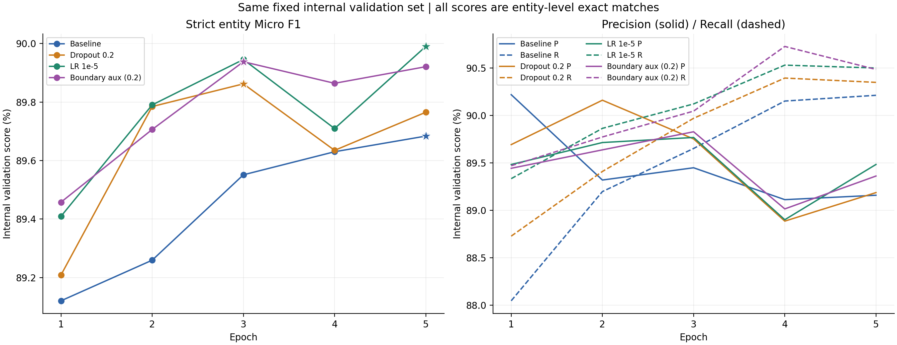
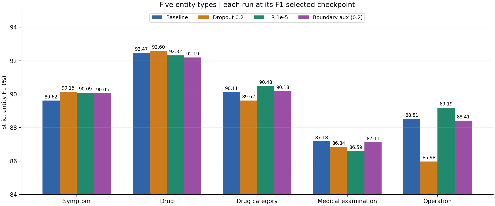
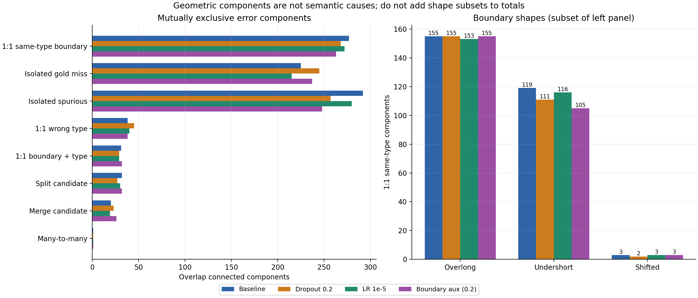
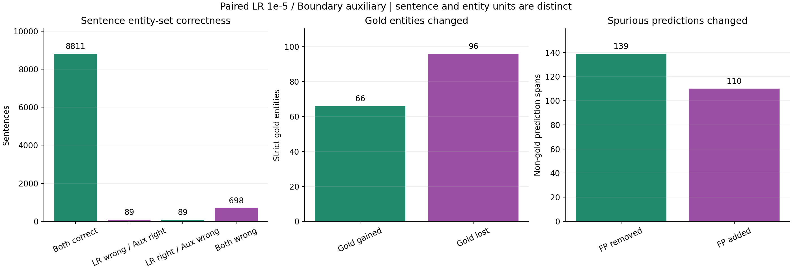

# BERT-CRF四轮正式实验：统一对照与边界分析

第四轮Boundary Auxiliary最佳严格实体Micro F1 **89.9380%**，相对Baseline+0.2542 pp、Dropout+0.0757 pp、第三轮LR1e-5 **−0.0522 pp**。当前内部Micro/Macro/Recall最高仍是第三轮E5；第四轮Precision最高。辅助训练真实生效，边界改善有限且伴随召回损失，尚不支持替换主候选。

[四轮完整JSON](../analysis/four_runs_comparison.json) · [全部标量CSV](../analysis/four_runs_comparison.csv) · [第四轮摘要](boundary_aux_summary.json) · [实际正式配置](../../../configs/bert_crf/boundary_aux_02.json) · [第四轮独立审计](boundary_aux_run1.md)

## 口径与四轮条件

四轮相同官方train内固定2225/247对话划分，val9687句、126049字符、6601实体。严格实体要求原始字符[start,end)和类型全对；P=TP/(TP+FP)、R=TP/(TP+FN)，五类F1等权Macro，零分母=0。所有分数为内部val，不是官方dev/test；本次没有调用官方dev/test或任何新正式训练。

| 实验 | LR | Dropout | 辅助λ | 最佳E | Precision | Recall | Micro F1 | Macro F1 | TP/FP/FN |
| --- | --- | --- | --- | --- | --- | --- | --- | --- | --- |
| Baseline | 2e-05 | 0.1 | 0 | 5 | 89.1601% | 90.2136% | 89.6837% | 89.5773% | 5955/724/646 |
| Dropout 0.2 | 2e-05 | 0.2 | 0 | 3 | 89.7537% | 89.9712% | 89.8623% | 89.0346% | 5939/678/662 |
| LR 1e-5 | 1e-05 | 0.1 | 0 | 5 | 89.4847% | 90.5014% | 89.9902% | 89.7347% | 5974/702/627 |
| Boundary Auxiliary | 1e-05 | 0.1 | .2 | 3 | 89.8292% | 90.0470% | 89.9380% | 89.5896% | 5944/673/657 |

| 第四轮减去 | ΔP/pp | ΔR/pp | ΔMicro F1/pp | ΔMacro F1/pp | ΔTP/FP/FN |
| --- | --- | --- | --- | --- | --- |
| Baseline | +0.669174 | -0.166641 | +0.254228 | +0.012266 | -11/-51/+11 |
| Dropout 0.2 | +0.075563 | +0.075746 | +0.075654 | +0.555000 | +5/-5/-5 |
| LR 1e-5 | +0.344506 | -0.454477 | -0.052245 | -0.145055 | -30/-29/+30 |

Baseline→Dropout只改变输出头Dropout.1→.2；Baseline→第三轮只改变统一LR2e-5→1e-5；第三轮→第四轮保留LR1e-5、Dropout.1与其余条件，增加Start/End分支和固定λ=.2的平衡BCE监督。与第二轮相比同时改变Dropout、LR和辅助训练，不能作单变量因果对照。全部实际配置、哈希、run、逐轮原精度见JSON。

## 收敛与Loss比较

所有主对照Loss均为原CRF序列NLL的样本平均，第四轮Total单独展示。第四轮Train CRF1.43672→.18176，Val CRF E1–5=.39413/.39095/.41612/.44793/.50016；最佳F1 E3=89.9380%，E5=89.9210%，未继续刷新。Train辅助Loss下降，Val辅助Loss最低E2后上升，未消除训练/验证分化。第三轮Val CRF最低E2、E5=.495046122，E2→E5上升.104689951；第四轮上升.109212279，两者接近，不能以E3较低NLL和第三轮E5相比就声称更好泛化。

第四轮E5总NLL略高但F1接近E3，表明概率校准/置信度与严格解码F1不等价。没有足够证据认定单纯训练不足；训练拟合继续增强且验证损失分化，不建议据此自动延长训练。最佳Epoch5/3/5/3分别由统一Micro F1规则产生，不改用低NLL选模。

fit时间：第二轮5490.146秒、第三轮5689.894秒、第四轮5789.781秒，第四轮比第三轮约+99.888秒（+1.76%），仅是实际机器观测。Baseline有中断及恢复，完整Epoch时间和6174.297秒，保留模型更新27765，历史全部调用记录至少29368更新（含被丢弃的部分E3）；精确物理更新数缺失。不同计时范围、负载和恢复开销不支持严格效率排名。

## 全部五类实体

| 实体 | Baseline P/R/F1 % | Dropout P/R/F1 % | LR P/R/F1 % | Boundary P/R/F1 % | ΔF1/pp(4−3) |
| --- | --- | --- | --- | --- | --- |
| Symptom | 88.8938/90.3530/89.6175 | 89.8748/90.4205/90.1468 | 89.4305/90.7578/90.0893 | 89.8746/90.2181/90.0460 | -0.0433 |
| Drug | 92.6593/92.2759/92.4672 | 92.9167/92.2759/92.5952 | 92.6389/92.0000/92.3183 | 92.3823/92.0000/92.1907 | -0.1276 |
| Drug_Category | 90.0204/90.2041/90.1121 | 90.2692/88.9796/89.6197 | 90.7598/90.2041/90.4811 | 90.3689/90.0000/90.1840 | -0.2970 |
| Medical_Examination | 87.0340/87.3171/87.1753 | 87.3355/86.3415/86.8357 | 86.0353/87.1545/86.5913 | 87.3977/86.8293/87.1126 | +0.5213 |
| Operation | 87.8419/89.1975/88.5145 | 84.9398/87.0370/85.9756 | 87.9880/90.4321/89.1933 | 87.3494/89.5062/88.4146 | -0.7787 |

| 实体 | Gold | 第四轮TP/FP/FN | 第四轮−第三轮TP/FP/FN |
| --- | --- | --- | --- |
| Symptom | 4447 | 4012/452/435 | -24/-25/+24 |
| Drug | 725 | 667/55/58 | +0/+2/+0 |
| Drug_Category | 490 | 441/47/49 | -1/+2/+1 |
| Medical_Examination | 615 | 534/77/81 | -2/-10/+2 |
| Operation | 324 | 290/42/34 | -3/+2/+3 |

相对第三轮，仅Medical_Examination F1提高**+0.5213 pp**，来自FP87→77，TP536→534、FN79→81，主要是误报减少而非找到更多Gold。Symptom−0.0433、Drug−0.1276、Drug_Category−0.2970、Operation−0.7787 pp，Operation退化最大。Drug TP相同但FP+2；Symptom TP−24/FP−25，主导总体召回下降。五类Macro第三轮89.7347%仍最高；第四轮89.5896%略高于Baseline89.5773%，明显高于Dropout89.0346%，不足以证明类别更加均衡。

## 边界错误专项

沿用第一轮已审计定义：去除全部精确TP后，对剩余Gold与预测的字符区间重叠建立二部图，用连通分量形成互斥分类。每行单位为几何分量，另列其FN/FP贡献；不得把分量、逐侧FN/FP或拆分/合并子项相加作总原因。拆分/合并是几何候选，不代表已确认语义原因。

| 互斥几何分量 | Baseline | Dropout | LR | Boundary | Δ(4−3) | 第四轮FN/FP |
| --- | --- | --- | --- | --- | --- | --- |
| 纯漏识别 | 225 | 245 | 215 | 237 | 22 | 237/0 |
| 纯误识别 | 292 | 257 | 280 | 248 | -32 | 0/248 |
| 一对一同类型边界 | 277 | 268 | 272 | 263 | -9 | 263/263 |
| 同边界异类型 | 38 | 45 | 40 | 38 | -2 | 38/38 |
| 边界和类型均错 | 31 | 29 | 29 | 32 | 3 | 32/32 |
| 拆分候选 | 32 | 27 | 30 | 32 | 2 | 32/64 |
| 合并候选 | 20 | 23 | 19 | 26 | 7 | 53/26 |
| 多对多复杂 | 1 | 1 | 1 | 1 | 0 | 2/2 |

| 形状/类别 | 第三轮 | 第四轮 | Δ |
| --- | --- | --- | --- |
| overextended | 153 | 155 | 2 |
| undercovered | 116 | 105 | -11 |
| shifted | 3 | 3 | 0 |
| Symptom | 179 | 176 | -3 |
| Drug | 19 | 19 | 0 |
| Drug_Category | 12 | 10 | -2 |
| Medical_Examination | 42 | 35 | -7 |
| Operation | 20 | 23 | 3 |

第四轮一对一同类型边界**272→263，−9**，过长153→155（+2）、过短116→105（−11）、平移3→3。Symptom179→176（−3），Medical42→35（−7），但Operation20→23（+3）。同边界异类型40→38（−2），Drug↔Drug_Category特定混淆却22→25（Drug→Category11→11，Category→Drug11→14），不能只用总错类下降掩盖该退化。

纯漏215→237（+22），纯误280→248（−32），合并候选19→26（+7）、拆分30→32（+2），边界和类型均错29→32（+3），复杂1→1。互斥边界分量减少不等于全部边界相关FN减少：逐侧同类型重叠FN333→339、FP347→345。部分一对一问题可能转为合并/其他结构，但不能仅凭汇总认定具体转移原因。总体FP702→673、FN627→657，局部边界收益伴随更多漏检。

## 类型×长度与长实体

实体长度为原始Unicode字符数，分组1/2/3–4/5–8/9+；TP/FN按Gold长度、FP按预测长度，边界错误可把两侧分到不同桶。Gold支持固定，涉及句子数可随预测不同；JSON保留完整四轮30组P/R/F1及TP/FP/FN。每类的句子计数字段沿用历史实现，表示该长度桶所有类型的并集，不能当作该类型独立句子支持数。

| 实体 | 字符数 | Gold | 第三轮P/R/F1 % (TP/FP/FN) | 第四轮P/R/F1 % (TP/FP/FN) | ΔF1/pp |
| --- | --- | --- | --- | --- | --- |
| ALL | 5-8 | 974 | 80.0990/83.0595/81.5524 (809/201/165) | 80.0197/83.4702/81.7085 (813/203/161) | +0.1561 |
| ALL | 9+ | 82 | 58.5366/58.5366/58.5366 (48/34/34) | 62.8205/59.7561/61.2500 (49/29/33) | +2.7134 |
| Symptom | 5-8 | 612 | 79.1935/80.2288/79.7078 (491/129/121) | 79.0400/80.7190/79.8707 (494/131/118) | +0.1629 |
| Symptom | 9+ | 52 | 43.3962/44.2308/43.8095 (23/30/29) | 48.9796/46.1538/47.5248 (24/25/28) | +3.7152 |
| Medical_Examination | 5-8 | 72 | 66.6667/75.0000/70.5882 (54/27/18) | 70.1299/75.0000/72.4832 (54/23/18) | +1.8950 |
| Medical_Examination | 9+ | 1 | 0.0000/0.0000/0.0000 (0/3/1) | 0.0000/0.0000/0.0000 (0/3/1) | +0.0000 |

5–8字总体+0.1561 pp，长Symptom5–8字+0.1629、9+字+3.7152 pp（Gold52，TP仅23→24，FP30→25）；Medical5–8字+1.8950 pp（Gold72，TP54不变、FP27→23），9+只有1个Gold、TP仍0，不能推断此类长实体已改善。9+总体58.5366→61.2500%，TP48→49/FP34→29，有限样本下波动较大。配对Gold找回中5–8字净+4、9+净+1，却2字净−31，是总体召回下降的重要长度来源。

全部组F1如下（P/R/计数与小组标记见JSON/CSV，零Gold与零预测分母按0，不能视为真实能力为0的充分证据）：

| 实体 | 长度 | Gold | Baseline F1% | Dropout F1% | LR F1% | Boundary F1% | Δ4−3/pp |
| --- | --- | --- | --- | --- | --- | --- | --- |
| ALL | 1 | 518 | 87.3213 | 87.9079 | 87.7026 | 88.1226 | +0.4200 |
| Symptom | 1 | 502 | 88.2122 | 88.8229 | 88.6051 | 89.0424 | +0.4373 |
| Drug | 1 | 5 | 0.0000 | 0.0000 | 0.0000 | 0.0000 | +0.0000 |
| Drug_Category | 1 | 11 | 72.0000 | 75.0000 | 75.0000 | 75.0000 | +0.0000 |
| Medical_Examination | 1 | 0 | 0.0000 | 0.0000 | 0.0000 | 0.0000 | +0.0000 |
| Operation | 1 | 0 | 0.0000 | 0.0000 | 0.0000 | 0.0000 | +0.0000 |
| ALL | 2 | 2864 | 93.9814 | 94.1093 | 94.2702 | 94.0906 | -0.1796 |
| Symptom | 2 | 2362 | 94.6811 | 94.9851 | 95.0042 | 94.7930 | -0.2112 |
| Drug | 2 | 94 | 89.3617 | 88.5246 | 89.3617 | 90.2174 | +0.8557 |
| Drug_Category | 2 | 18 | 51.6129 | 66.6667 | 60.0000 | 66.6667 | +6.6667 |
| Medical_Examination | 2 | 165 | 90.0621 | 89.0966 | 89.1641 | 88.4013 | -0.7628 |
| Operation | 2 | 225 | 94.3052 | 92.3788 | 94.5701 | 94.0367 | -0.5334 |
| ALL | 3-4 | 2163 | 89.6457 | 89.6805 | 89.9611 | 89.7987 | -0.1624 |
| Symptom | 3-4 | 919 | 87.6130 | 87.9699 | 87.9320 | 87.7268 | -0.2052 |
| Drug | 3-4 | 417 | 92.8401 | 93.4446 | 92.9172 | 92.8571 | -0.0600 |
| Drug_Category | 3-4 | 373 | 94.4669 | 93.9891 | 94.4520 | 93.8942 | -0.5578 |
| Medical_Examination | 3-4 | 377 | 89.0957 | 89.0667 | 89.4180 | 90.1596 | +0.7416 |
| Operation | 3-4 | 77 | 77.3006 | 73.8095 | 80.4878 | 78.1065 | -2.3813 |
| ALL | 5-8 | 974 | 81.2813 | 81.6040 | 81.5524 | 81.7085 | +0.1561 |
| Symptom | 5-8 | 612 | 78.5600 | 79.7744 | 79.7078 | 79.8707 | +0.1629 |
| Drug | 5-8 | 184 | 93.6986 | 93.4783 | 92.9730 | 92.1409 | -0.8321 |
| Drug_Category | 5-8 | 84 | 83.1461 | 79.3478 | 83.1461 | 82.6087 | -0.5374 |
| Medical_Examination | 5-8 | 72 | 74.0260 | 73.4694 | 70.5882 | 72.4832 | +1.8950 |
| Operation | 5-8 | 22 | 74.5098 | 72.7273 | 70.5882 | 74.5098 | +3.9216 |
| ALL | 9+ | 82 | 57.8616 | 60.0000 | 58.5366 | 61.2500 | +2.7134 |
| Symptom | 9+ | 52 | 40.4040 | 45.5446 | 43.8095 | 47.5248 | +3.7152 |
| Drug | 9+ | 25 | 98.0392 | 96.0000 | 97.9592 | 97.9592 | +0.0000 |
| Drug_Category | 9+ | 4 | 33.3333 | 33.3333 | 33.3333 | 33.3333 | +0.0000 |
| Medical_Examination | 9+ | 1 | 0.0000 | 0.0000 | 0.0000 | 0.0000 | +0.0000 |
| Operation | 9+ | 0 | 0.0000 | 0.0000 | 0.0000 | 0.0000 | +0.0000 |

## 第三轮与第四轮逐句配对

按相同原始(dialogue_id,sentence_id)配对，句子正确定义为全部严格实体集合相等，包括空实体句。两轮都正确8811句、第三错第四对89、第三对第四错89、都错698，共9687；两轮错误句均787，不能由此说实体错误相同。9432句预测完全相同、255句不同，其中20句TP/FP/FN计数相同、65句严格句F1相同；这些重叠诊断不相加。

Gold实体两轮都找对5878，第四轮新找回66、丢失96，两轮都漏561，总6601；净TP−30。FP持久563、删除139、新增110，净FP−29。新找回/丢失按类型：Symptom42/66、Drug6/6、Drug_Category2/3、Medical12/14、Operation4/7；新找回并未抵消新增漏检。按既有逐侧分类，66个找回中41曾与同类型错误边界重叠，96个新丢失中55在第四轮成为同类边界重叠；该口径不是互斥一对一分量，不能与−9直接等同。

## 起点终点诊断及不确定性

最终CRF端点诊断独立于辅助头：每句对类别无关的Gold/预测起点字符位置集合求交，终点用end−1，同一任务Gold6601、预测数量分别6676与6617。第三轮→第四轮起点P/R/F1=92.3158/93.3646/92.8372%→92.8064/93.0314/92.9187%，终点93.4092/94.4705/93.9369%→93.7132/93.9403/93.8266%；起点F1+0.0815 pp、终点−0.1103 pp，端点Recall均下降。位置交集忽略类型和另一侧是否同时正确，不是完整实体配对。

第四轮辅助头E3 Start P/R/F1=81.3389/97.0005/88.4820%，End=85.3250/97.2428/90.8949%；高Recall伴随较多额外边界。阈值固定0.5，不用于CRF后处理，不参与最佳Epoch选择。E1→E5辅助Start/End F1从80.2731/87.5829%到89.8387/91.9865%（精确各轮记录见独立报告），最终CRF实体F1并未单调提高，因此不能把辅助任务学到信号写成NER边界已解决。

Bootstrap完全复用既有实现：247个完整对话为配对采样单位，每次有放回采247个对话且保留全部句子，10000次，NumPy default_rng seed20261021；每次汇总TP/预测/Gold后计算两轮MicroF1差。第四轮−第三轮点估计−0.052245 pp，探索性95%百分位区间**[-0.425594, +0.323772] pp**，中位数-0.048737，重复样本中Delta>0比例0.3988（不是训练胜出概率或p值）。区间跨零，证据不足以支持稳定优势，也没有证明无收益。

该区间条件于当前训练种子及已按同一val选出的Checkpoint，不包含跨训练seed不确定性；同一内部val多轮探索有选择偏差，非独立确认集，不能推广为官方测试效果或普遍显著性。

## 分层结论与下一步

**已验证事实**：辅助头、λ=.2联合损失、全参数优化和保存加载有效；E3最好但未超过第三轮；部分一对一边界/长实体指标改善，纯漏和合并问题增加。**数据支持观察**：第四轮更偏Precision，Medical改善主要来自FP减少；长组有小收益但2字实体损失更大，Macro与Recall下降。**待验证假设**：初始最长Batch辅助梯度较弱可能限制长实体收益，平衡BCE可能改变置信度与取舍；当前数据不能单独归因，不能据此决定下一轮λ或新架构。

推荐继续保留**第三轮LR1e-5/E5为主候选**，冻结四份已审计Checkpoint与代码供小组交接，第四轮作为有效但未胜出的研究结果归档。四轮Micro/Macro/Recall最高均为第三轮，Precision最高为第四轮；没有模型在所有目标上统一占优。

若还有研究预算，先复核第四轮新增短实体漏检、Operation过长及合并候选，再决定是否值得做第三/第四轮的配对多seed稳定性验证。唯一主要变量仍是有无同一固定边界辅助目标，保持每对seed、划分、预训练、LR、Dropout、预算及选模一致；报告每seed差值、均值/离散度和边界计数。现有每次约95–97分钟，新增两seed×两模型约6.4小时，是真实耗时尺度的预算估计而非承诺。可能澄清当前小差异的稳定性，也可能表明收益有限，成本高于先做局部错误复核。

当前**不建议**自动搜索λ、叠加Dropout.2、延长训练、增加多种结构或使用官方dev/test继续调参；这些会改变研究问题或扩大验证选择偏差。没有证据支持指定下一轮数值。若课程交接优先，应停止进一步调参并冻结第三轮；本次到归档后结束，无第五轮。

## 证据与公开范围

完整审计本地`docs/bert_crf/evidence/20261022T200005+0800_boundary_aux_result_audit`，发布过程在其`publication/`；原训练与启动路径见独立报告。公开完整必要源码/测试/正式配置、两份报告、摘要、四轮聚合JSON/CSV及6张图，保留所有退化类、失败历史与局限的说明。原始文本、逐句记录、Checkpoint、日志及资源过程文件继续本地受控保存。数据、权重、原始资源证据未托管在GitHub，获取匹配受控资源后才能复现。
