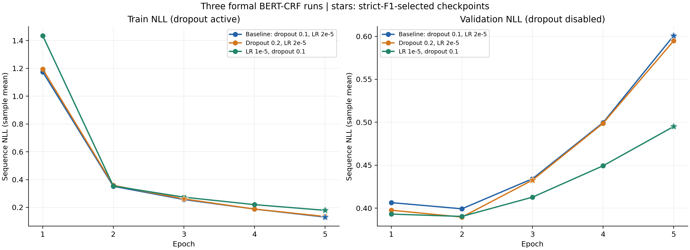
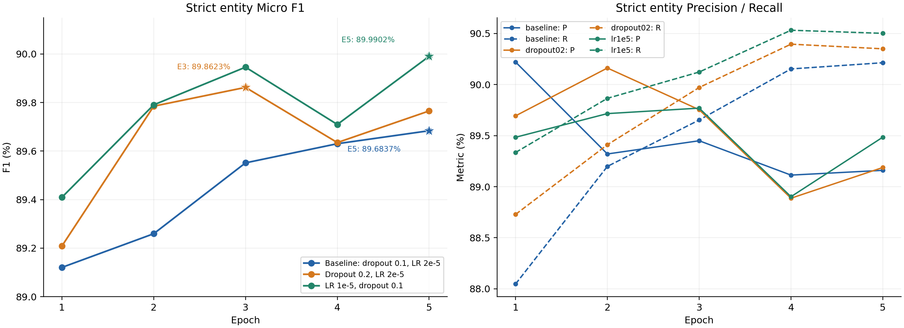
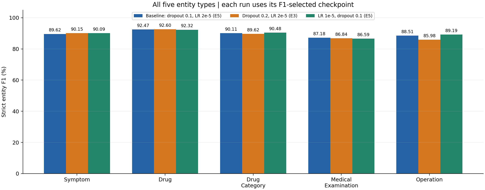
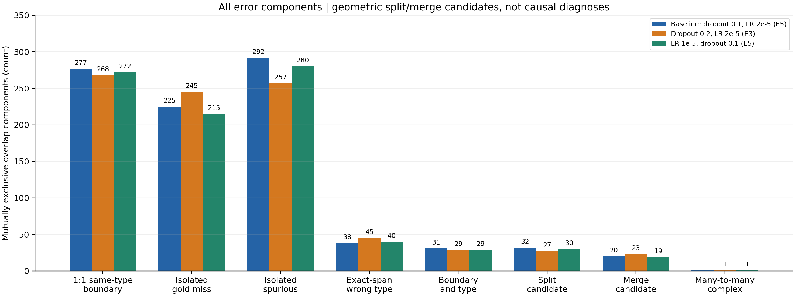

# BERT-CRF 第三轮学习率实验审计与三轮正式对照

## 一、执行摘要

第三轮在 Baseline 基础上仅将学习率 2e-5 降至 1e-5，输出头 Dropout 保持0.1。训练正常完成5轮，退出码0，未早停、未中断或恢复。最佳 Epoch=5，内部验证集严格实体 Micro P/R/F1=89.4847/90.5014/89.9902%，Macro F1=89.7347%。

相对 Baseline，Micro F1 +0.3065 pp，Macro F1 +0.1573 pp；TP +19、FP -22、FN -19。验证 NLL 后期仍上升，但 E2→E5 上升由 0.201577 降至 0.104690。

改善不是全面的：Symptom、Drug_Category、Operation 的F1提高，Drug、Medical_Examination下降。LR1e-5/E5是当前内部 Micro/Macro F1最高候选；这不是官方dev/test成绩或已证明的普遍最优参数。

按247个对话、10000次Bootstrap得到 Delta Micro F1 的探索性95%百分位区间 [-0.0601, +0.6744] pp，跨零。不能宣称稳定改善。

## 二、实验身份与完整性

| 项目 | 真实记录 |
| --- | --- |
| run_id | 20261021T195736+0800_real_training_95abb833 |
| 配置 | [lr_1e-5.json](../../../configs/bert_crf/lr_1e-5.json) |
| 配置SHA-256 | 3dcb3e0942bdc74b0a8d9f7db3a0a1d44c4b0f36b9fb7b8da3ec16347f77aef0 |
| 配置语义指纹 | 477e710e9e42d5e3c6b15e4ffa46a30884c0d954413f67c0f8d7ac27f8b9be09 |
| 训练Git / 分支 | f15da70b09dd0d7e1a3946f53bf346146ea5db2f / dxc |
| 启动 / 正式run创建 | 2026-10-21T19:56:39.912306+08:00 / 2026-10-21T19:57:36.873234+08:00 |
| 逻辑结束 / 进程退出 | 2026-10-21T21:32:27.735453+08:00 / 2026-10-21T21:32:29.200865+08:00 |
| 运行状态 / 退出码 / Epoch | completed / 0 / 5 |
| 更新次数 | 27765（每轮5553） |
| 训练fit耗时 | 5689.893699秒，约94.83分钟 |
| 启动至进程退出 | 5749.288559秒（含Preflight/初始化） |
| 最佳Checkpoint | experiments/bert_crf/20261021T195736+0800_real_training_95abb833/checkpoints/epoch_0005.pt |
| Checkpoint SHA-256 | e5ee6aaa8d4a00a4626553002aa9a63253a8ee0139463fec2bb41427bf391bed |
| Checkpoint大小 | 1220509451 bytes |
| 过程身份 | 训练PID12100、启动器11192；独立监督器保留退出码；无重启 |
| 原始产物完整性 | 5份Checkpoint、5轮验证预测/错误、history、metrics、manifest、run_info、源码快照齐全 |

实际命令（项目根目录执行；日志中的本机绝对路径公开时改为等价项目相对路径）：

```text
.venv-bert-crf/Scripts/pythonw.exe -u -X utf8 scripts/train_bert_crf.py --config configs/bert_crf/lr_1e-5.json --train --preflight-output .local/bert_crf/20261021T194908+0800_lr1e5_launch/preflight_training
```

正式训练初始化没有 --resume，formal_training_started.resume_from=null；初始参数哈希与Baseline资源探测相同。未加载前两轮微调Checkpoint用于训练。

资源证据复用Baseline原文件，SHA-256 `a51cec631245624cd95796592882b9ea20f25927cd07b4d6b0c845cdda30fd35`。实际校验绑定模型配置、输入哈希、packages/GPU/CUDA/capability，以及Batch、最长输入、reserve=3、零更新和显存余量；不绑定学习率。本轮两次正式入口Preflight均PASS、optimizer_steps=0、参数哈希和版本不变。最长真实输入[16,201]，探测峰值reserved=4099932160 bytes，结束可用3192913920 bytes。没有绕过保护，也没有新造或改写资源证据。第二轮早先资源身份不匹配的失败及零更新补证保留在原本地证据目录，不计入正式成绩。

## 三、学习率单变量对照有效性

| 配置项 | Baseline | Dropout 0.2 | LR 1e-5 |
| --- | --- | --- | --- |
| 输出头Dropout | 0.1 | 0.2 | 0.1 |
| BERT/Linear/CRF基准LR | 2e-5 | 2e-5 | 1e-5 |
| BERT hidden/attention Dropout | 0.1 / 0.1 | 0.1 / 0.1 | 0.1 / 0.1 |
| Epoch / Batch / Seed | 5 / 16 / 42 | 5 / 16 / 42 | 5 / 16 / 42 |
| AdamW betas / epsilon | (0.9,0.999) / 1e-8 | 相同 | 相同 |
| Weight decay / 梯度裁剪 | 0.01 / 1.0 | 相同 | 相同 |
| Scheduler / Warmup | Linear / ratio0.1,2777步 | 相同 | 相同 |
| 计划更新 / 累积 | 27765 / 1 | 相同 | 相同 |
| 早停 / 最佳模型 | patience2 / strict micro F1最大，平分保留更早 | 相同 | 相同 |
| 精度 / AMP / deterministic | FP32 / false / true | 相同 | 相同 |
| Padding / max_tokens / workers | 动态最长 / 256 / 0，禁止截断 | 相同 | 相同 |
| BERT / Tokenizer | google-bert/bert-base-chinese，固定revision | 相同 | 相同 |
| 字符监督 / 映射 / CRF | 原始字符BIO / offset_share_unique_v1 / strict_bio_v1 | 相同 | 相同 |

Baseline与第三轮实际formal配置结构化Diff只有 `training.learning_rate: 2e-5 → 1e-5`；experiment_name沿用兼容值first_baseline，由独立配置路径、哈希、语义指纹和run_id区分，不改变计算。资源证据引用也相同。源码Git提交不同仅涉及归档；Baseline源码快照的 36 个已有文件哈希与第三轮和当前版本一致，src/scripts/tests无计算差异。

实际AdamW构造使用 `model.parameters()`，只有一个参数组，包含197个BERT参数张量、2个Linear及3个CRF，共202个。五份Checkpoint均验证initial_lr=1e-5、scheduler.base_lrs=[1e-5]和完整更新计数。Warmup第0步实际LR为0，第2777步达到基准LR；只改变调度幅度，不改变比例或步数。

输出头配置只作用于CharacterBertCRF.head.dropout，位置为字符映射→Dropout→Linear→CRF；本轮及Checkpoint重新加载时输出头、BERT hidden/attention均为0.1。

固定模型/Tokenizer revision：`8f23c25b06e129b6c986331a13d8d025a92cf0ea`。数据版本 `IMCS-V2-NER_train_sha256_07cdd379`，split `split_v1_sha256_497f21cf`；88842个train句子与9687个val句子，val共126049字符/6601实体/247对话。输入哈希已核对，未重划分、未改金标。完整正式配置另见仓库配置文件，完整版本及哈希见结构化数据。

结论：Baseline↔第三轮是有效学习率单变量对照；Baseline↔第二轮是Dropout单变量对照；第二轮↔第三轮同时改变两项，只可比较整体方案。

## 四、第三轮完整训练结果与独立核验

| Epoch | Train NLL | Val NLL | P(%) | R(%) | F1(%) | Epoch末LR | 耗时(秒) | 当轮新最佳 |
| --- | --- | --- | --- | --- | --- | --- | --- | --- |
| 1 | 1.434992 | 0.393075 | 89.4841 | 89.3349 | 89.4094 | 8.88906675204e-06 | 1215.811 | 是 |
| 2 | 0.353919 | 0.390356 | 89.7157 | 89.8652 | 89.7904 | 6.66680006403e-06 | 1175.823 | 是 |
| 3 | 0.273471 | 0.412790 | 89.7691 | 90.1227 | 89.9456 | 4.44453337602e-06 | 1094.051 | 是 |
| 4 | 0.219717 | 0.449323 | 88.9021 | 90.5317 | 89.7095 | 2.22226668801e-06 | 1096.208 | 否 |
| 5 | 0.178814 | 0.495046 | 89.4847 | 90.5014 | 89.9902 | 0 | 1107.926 | 最终最佳 |

学习率列是Epoch结束后Scheduler值；每个Batch实际使用的是更新前值，已逐一对照27765条日志验证。Train NLL按所有Batch样本数加权重算，与history一致。训练loss/LR/裁剪前梯度范数均有限，无NaN/Inf/OOM/保存失败记录。

独立评分按(dialogue_id,sentence_id)复合ID对齐原始金标；第三轮5轮均完整覆盖9687句，没有重复、多余或缺失ID，字符和标签长度一致，BIO合法。实体采用Python字符半开跨度[start,end)，边界与类型同时相同才计TP。原Metrics实现与既有独立span方法同时复用；总体、五类统计、Macro、errors.jsonl全部精确匹配。最佳模型按严格Micro F1最大选E5，平分保留更早规则未改变。前两轮最佳预测也在本轮重算并重现已归档指标与全部长度/错误统计，未重新审查其已确认恢复链。

5份Checkpoint实际读取：模型张量有限、优化器step、Scheduler、配置、运行身份和Python/NumPy/CPU/CUDA RNG完整。最佳Checkpoint重载后对首16句、最长16句、首16个错误句去重的47句推理，与已保存预测全部一致；有无gold输入解码相同。审计未构造优化器、未反向、未更新参数。Checkpoint内部最佳hash的自引用槽可为null，外部checkpoint_info、manifest和实际文件SHA一致；不将该设计误判为损坏。

Validation NLL仅核对history、epoch事件、validation_info和metrics，未全量重新前向复算；抽样推理验证不能替代全量NLL核验。

## 五、三轮总体成绩与直接对照

| 实验 | Dropout | LR | 最佳Epoch | P | R | Micro F1 | Macro F1 |
| --- | --- | --- | --- | --- | --- | --- | --- |
| Baseline | 0.1 | 2e-05 | 5 | 89.1601% | 90.2136% | 89.6837% | 89.5773% |
| Dropout 0.2 | 0.2 | 2e-05 | 3 | 89.7537% | 89.9712% | 89.8623% | 89.0346% |
| LR 1e-5 | 0.1 | 1e-05 | 5 | 89.4847% | 90.5014% | 89.9902% | 89.7347% |

| 指标 | Baseline | LR 1e-5 | Delta（第三轮−Baseline） |
| --- | --- | --- | --- |
| 最佳Epoch | 5 | 5 | 0 |
| Precision | 89.1601% | 89.4847% | +0.3247 pp |
| Recall | 90.2136% | 90.5014% | +0.2878 pp |
| F1 | 89.6837% | 89.9902% | +0.3065 pp |
| Macro F1 | 89.5773% | 89.7347% | +0.1573 pp |
| TP | 5955 | 5974 | +19 |
| FP | 724 | 702 | -22 |
| FN | 646 | 627 | -19 |
| 最佳F1模型Val NLL | 0.600812 | 0.495046 | -0.105766 |
| 保留训练谱系更新数 | 27765 | 27765 | 0 |
| 完整Epoch耗时合计(秒) | 6174.297 | 5689.820 | 计时口径说明见下 |

第三轮较第二轮Micro F1 +0.1279 pp、Macro F1 +0.7001 pp；TP +35、FP +24、FN -35。其Recall更高但Precision更低，是取舍，不能归因于单独学习率。

三轮最佳TP/FP/FN依次为5955/724/646、5939/678/662、5974/702/627。第三轮相对Baseline的P和R均提高，FP/FN均减少，整体方向一致；Micro与Macro也同向。幅度仍小，不是突破性改善。三轮中LR1e-5的Micro/Macro/Recall最高，Dropout0.2的Precision最高；各类别仍无全面支配的方案。

耗时：Baseline完整Epoch合计6174.297秒；既有审计的活动时间估计6570.953秒，含被丢弃的部分训练且计时边界不同。第二轮fit5490.146秒；第三轮fit5689.894秒（1小时34分49.894秒）。Baseline保留谱系更新27765，但所有调用已记录更新29368，包含丢弃的部分Epoch1603；因强制停止可能发生更新后未落日志，精确物理总更新未知。不将耗时差解释为学习率造成的速度提升。

## 六、训练曲线与泛化表现





| Epoch | Baseline Train/Val NLL | Dropout0.2 Train/Val NLL | LR1e-5 Train/Val NLL | 三轮F1(%)：B/D/L |
| --- | --- | --- | --- | --- |
| 1 | 1.174061 / 0.406410 | 1.194278 / 0.397576 | 1.434992 / 0.393075 | 89.1206 / 89.2087 / 89.4094 |
| 2 | 0.351774 / 0.399235 | 0.358245 / 0.389603 | 0.353919 / 0.390356 | 89.2595 / 89.7847 / 89.7904 |
| 3 | 0.256393 / 0.434228 | 0.260794 / 0.432673 | 0.273471 / 0.412790 | 89.5513 / 89.8623 / 89.9456 |
| 4 | 0.187812 / 0.499640 | 0.188099 / 0.498805 | 0.219717 / 0.449323 | 89.6302 / 89.6350 / 89.7095 |
| 5 | 0.130306 / 0.600812 | 0.134417 / 0.594835 | 0.178814 / 0.495046 | 89.6837 / 89.7652 / 89.9902 |

第三轮Train NLL从1.434992降至0.178814；Baseline从1.174061降至0.130306。降低LR使本次训练拟合更保守，但不能仅凭较高Train NLL认定欠拟合；训练阶段Dropout启用、验证关闭，两种NLL不是完全同分布测量。

三轮最低Val NLL都在E2。Baseline E2→E5增加0.201577，第二轮增加0.205232，第三轮增加0.104690。第三轮每个相同Epoch的Val NLL都低于Baseline，上升幅度约减少48.06%，但仍保留后期上升风险。相同E5的0.495046低于Baseline0.600812；第二轮最佳E3的0.432673不能直接与第三轮E5的差值全部归因于参数。

第三轮F1为89.4094→89.7904→89.9456→89.7095→89.9902%，E4回落且FP增加至746，E5恢复；无数值不稳定证据，但并非单调收敛。E3到E5净增仅0.0446 pp。最佳E5与Baseline相同，比第二轮E3晚。固定5轮内已达到三轮最高F1，无明显严重训练不足证据；是否已充分收敛或增加Epoch有益尚不能确定，不能据此自动延长训练。Val NLL和实体F1的结论应分开：本轮两者都较Baseline改善，但最佳NLL和最佳F1仍不是同一Epoch。

## 七、五类实体对照



表内P/R/F1单位均为%，括号为TP/FP/FN。

| 类型 | Gold | Baseline P/R/F1（计数） | Dropout0.2 P/R/F1（计数） | LR1e-5 P/R/F1（计数） | LR−B F1 |
| --- | --- | --- | --- | --- | --- |
| Symptom | 4447 | 88.8938/90.3530/89.6175 (4018/502/429) | 89.8748/90.4205/90.1468 (4021/453/426) | 89.4305/90.7578/90.0893 (4036/477/411) | +0.4718 pp |
| Drug | 725 | 92.6593/92.2759/92.4672 (669/53/56) | 92.9167/92.2759/92.5952 (669/51/56) | 92.6389/92.0000/92.3183 (667/53/58) | -0.1488 pp |
| Drug_Category | 490 | 90.0204/90.2041/90.1121 (442/49/48) | 90.2692/88.9796/89.6197 (436/47/54) | 90.7598/90.2041/90.4811 (442/45/48) | +0.3689 pp |
| Medical_Examination | 615 | 87.0340/87.3171/87.1753 (537/80/78) | 87.3355/86.3415/86.8357 (531/77/84) | 86.0353/87.1545/86.5913 (536/87/79) | -0.5840 pp |
| Operation | 324 | 87.8419/89.1975/88.5145 (289/40/35) | 84.9398/87.0370/85.9756 (282/50/42) | 87.9880/90.4321/89.1933 (293/40/31) | +0.6788 pp |

Symptom贡献净TP+18、FP-25，是总体收益主体；Drug_Category TP不变、FP-4；Operation TP+4、FP不变。Drug TP-2且FP不变；Medical_Examination TP-1、FP+7，是最大F1退化（-0.5840 pp），不能称为解决重点弱类。Operation相对Baseline+0.6788 pp，是本轮类别最大提升，避免了第二轮的明显总体退化；不过其324个Gold实体中的少数变化即可推动百分比。

第三轮Macro提高0.1573 pp，但仍存在医学检查短板。它在五类的最低F1并未高于Baseline（86.5913% vs87.1753%），不能笼统声称所有类别更均衡；按固定五类平均更好，按最低类别仍Baseline较好。

## 八、实体长度与错误模式

长度沿用1、2、3–4、5–8、9+字符。TP/FN按Gold跨度长度，FP按预测跨度长度；一次边界错误可把FN和FP分到不同组。表中Gold支持固定，涉及句子数按整组任一Gold/预测出现统计，可随方案变化，不作为类型支持数。

| 长度 | Gold | Baseline P/R/F1（TP/FP/FN） | Dropout0.2 P/R/F1（TP/FP/FN） | LR1e-5 P/R/F1（TP/FP/FN） | LR−B F1 |
| --- | --- | --- | --- | --- | --- |
| 1 | 518 | 86.2524/88.4170/87.3213 (458/73/60) | 87.4046/88.4170/87.9079 (458/66/60) | 86.6290/88.8031/87.7026 (460/71/58) | +0.3813 pp |
| 2 | 2864 | 94.4621/93.5056/93.9814 (2678/157/186) | 95.0820/93.1564/94.1093 (2668/138/196) | 94.6184/93.9246/94.2702 (2690/153/174) | +0.2888 pp |
| 3-4 | 2163 | 88.6528/90.6611/89.6457 (1961/251/202) | 89.1682/90.1988/89.6805 (1951/237/212) | 89.0045/90.9385/89.9611 (1967/243/196) | +0.3154 pp |
| 5-8 | 974 | 79.2969/83.3676/81.2813 (812/212/162) | 79.7258/83.5729/81.6040 (814/207/160) | 80.0990/83.0595/81.5524 (809/201/165) | +0.2711 pp |
| 9+ | 82 | 59.7403/56.0976/57.8616 (46/31/36) | 61.5385/58.5366/60.0000 (48/30/34) | 58.5366/58.5366/58.5366 (48/34/34) | +0.6750 pp |

| 类型×长度 | Gold | Baseline F1 | Dropout0.2 F1 | LR1e-5 F1 | LR−B | LR TP/FP/FN |
| --- | --- | --- | --- | --- | --- | --- |
| Operation 2 | 225 | 94.3052% | 92.3788% | 94.5701% | +0.2649 pp | 209/8/16 |
| Operation 3-4 | 77 | 77.3006% | 73.8095% | 80.4878% | +3.1872 pp | 66/21/11 |
| Symptom 5-8 | 612 | 78.5600% | 79.7744% | 79.7078% | +1.1478 pp | 491/129/121 |
| Medical_Examination 5-8 | 72 | 74.0260% | 73.4694% | 70.5882% | -3.4377 pp | 54/27/18 |
| Operation 5-8 | 22 | 74.5098% | 72.7273% | 70.5882% | -3.9216 pp | 18/11/4 |
| Symptom 9+ | 52 | 40.4040% | 45.5446% | 43.8095% | +3.4055 pp | 23/30/29 |
| Medical_Examination 9+ | 1 | 0.0000% | 0.0000% | 0.0000% | +0.0000 pp | 0/3/1 |

Symptom5–8字TP仍491，FP147→129，F1提升来自误报减少；9+字TP20→23，FP27→30，P/R均略升但仅52个Gold。医学检查5–8字TP57→54、FP25→27，F1下降3.4377 pp（Gold72）；9+字Gold只有1，不作参数结论。Operation3–4字TP63→66、FP23→21，F1提升3.1872 pp；5–8字TP19→18、FP10→11，F1下降3.9216 pp，Gold只有22。总体5–8字虽F1小升，TP812→809，不能解释为全面找回更多长实体。9+字总体Gold82，也应谨慎。



| 互斥错误分量 | Baseline | Dropout0.2 | LR1e-5 | LR−B | LR分量贡献FN/FP |
| --- | --- | --- | --- | --- | --- |
| 一对一同类型边界错误 | 277 | 268 | 272 | -5 | 272/272 |
| 纯漏识别 | 225 | 245 | 215 | -10 | 215/0 |
| 纯误识别 | 292 | 257 | 280 | -12 | 0/280 |
| 同边界异类型 | 38 | 45 | 40 | 2 | 40/40 |
| 边界和类型均错 | 31 | 29 | 29 | -2 | 29/29 |
| 一对多拆分候选 | 32 | 27 | 30 | -2 | 30/60 |
| 多对一合并候选 | 20 | 23 | 19 | -1 | 39/19 |
| 多对多复杂分量 | 1 | 1 | 1 | 0 | 2/2 |

去除精确TP后，对重叠Gold-FN与预测-FP建二分图，连通分量互斥计数。Baseline FN646/FP724、第三轮FN627/FP702，分量贡献严格可加总。1:1同类型边界277→272，仅减少5；其中预测过长155→153、过短119→116、平移3→3。纯漏识别225→215、纯误识别292→280，拆分32→30、合并20→19；同边界错类38→40反而增加。拆分/合并是几何候选，不确认语义成因；一次边界错同时产生FP/FN，不能当两次独立根因。

按类型，Symptom的1:1同类边界192→179，Medical_Examination37→42、Drug16→19；Operation20→20。因此边界改善主要在症状，医学检查边界问题恶化。Drug↔Drug_Category同边界混淆各方向仍11→11，总数22→22；所有精确边界错类略增主要来自其他方向。全部类型×长度的TP/FP/FN与P/R/F1、侧边错误分类、类型混淆方向在完整JSON与附录中保留。

## 九、逐句配对预测与探索性不确定性

| 计数单位 | 事件 | 数量 |
| --- | --- | --- |
| 句子 | 两轮均正确 | 8805 |
| 句子 | Baseline错→第三轮对 | 95 |
| 句子 | Baseline对→第三轮错 | 68 |
| 句子 | 两轮均错 | 719 |
| 句子 | 预测不同 | 245 |
| 句子 | 预测不同但TP/FP/FN相同 | 22 |
| 句子 | 预测不同但有理数句级F1相同 | 64 |
| Gold实体 | 两轮均找回 | 5888 |
| Gold实体 | 第三轮新找回 | 86 |
| Gold实体 | 第三轮新丢失 | 67 |
| Gold实体 | 两轮均漏掉 | 560 |
| 非Gold预测跨度 | 保留FP | 594 |
| 非Gold预测跨度 | 删除FP | 130 |
| 非Gold预测跨度 | 新增FP | 108 |

实体全对句由8873增至8900，净+27；找回86、丢失67，净TP+19；删除FP130、新增FP108，净FP-22。改善与新增错误同时存在。找回按类型为Symptom60、Drug6、Drug_Category2、Medical11、Operation7；丢失分别42、8、2、12、3。找回的原FN以同类边界49和无重叠31为主；新丢失中同类边界39、无重叠21。上述是实体配对转变，不是互斥错误分量，可重复涉及同一句，不与分量表相加。

Bootstrap完全复用第二轮方法与规模：固定seed20261021，247个对话有放回重采样10000次，同一对话所有句子共同抽样；每次从TP、预测数和Gold数合计重算Micro F1差。2.5/50/97.5百分位为 -0.060109/+0.304755/+0.674378 pp，正差比例0.9518。未根据结果调整次数或种子。第二轮对应区间[-0.2628,+0.6370] pp也跨零。正差比例不是参数优于Baseline的后验概率，不作普遍显著性结论；重采样不能估计训练seed波动，也未消除同一val选模偏倚。

## 十、实验结论与候选选择

**A. 直接事实：** 第三轮完成5轮、E5最佳，P/R/Micro/Macro均高于Baseline，Val NLL同Epoch更低；医学检查和Drug下降，同边界错类增加。当前内部Micro/Macro/Recall最高是LR1e-5/E5，Precision最高是Dropout0.2/E3，医学检查F1最高仍是Baseline/E5。

**B. 有证据支持的判断：** 较低LR在本次运行中改善了整体拟合与验证损失的取舍，主要收益来自症状误报减少和部分漏检找回，后期NLL上升缓解但未消除。可保留LR1e-5/E5为主候选，同时保留另外两个检查点以供任务目标取舍；它没有在所有类别或所有长实体组上胜出。

**C. 待验证假设：** 低LR收益能否跨seed保持；E5最佳是否意味着更长训练仍有益；低LR与Dropout0.2组合是否互补。现有三轮不包含该组合，不能由两条单因素结果推断组合一定更好。

**D. 当前不建议：** 广泛网格搜索、同时改LR/Dropout/Batch/WeightDecay、改CRF或字符映射、用官方dev/test反复调参、为了曲线好看而换选模规则或延长Epoch。没有发现实现错配证据，优先处理稳定性和任务交接。

## 十一、下一步建议（本轮均不执行）

1. **优先冻结当前候选与交接协议。** 如果课程时间/算力紧张，冻结LR1e-5/E5为暂定主候选，记录其医学检查退化和单seed局限，保留Baseline及Dropout0.2作为备选。准备组员交接和评估口径，是否生成官方预测需之后明确授权。没有必要只为再多零点几个百分点无限调参。

2. **如有预算，优先配对多seed稳定性验证。** 假设是LR降低的收益可重复。唯一研究变量仍是LR；Dropout固定0.1、相同5轮预算/数据/评价；每个新增seed在两个LR下各训练一次，把seed作为配对重复因素，不混入超参数变化。建议新增2对seed=4次运行，按已观测fit约1.5–1.8小时/次估计约6–8 GPU小时（含加载/检查的实际成本另记）。收益是估计稳定性，风险是小收益反转和计算成本；优先于继续堆叠新超参数。具体seed与执行另行授权。

3. **只有仍需一项参数对照时，考虑组合的增量检验。** 以第三轮LR1e-5/Dropout0.1为锚，单独将输出头Dropout调至0.2，其他条件及seed42保持；这才是组合点上的Dropout单变量检验。假设是症状FP收益可与低LR互补，但第二轮Recall/Operation退化说明也可能有害。预计1次完整运行约1.5–2小时加必要Preflight；其优先级低于稳定性验证，不自动执行。当前不建议先改变Epoch上限：E3→E5收益小而NLL持续升，延长会引入新预算和更强选模机会。

## 十二、证据与可复现边界

- [第三轮真实配置](../../../configs/bert_crf/lr_1e-5.json) · [第三轮结构化摘要](lr1e5_summary.json) · [三轮完整聚合数据](../analysis/three_experiments_comparison.json)。
- [既有Baseline报告](baseline_run1.md) · [既有Dropout对照报告](dropout02_vs_baseline.md)。
- 本轮本地审计：`docs/bert_crf/evidence/20261021T214932+0800_lr1e5_result_audit/`；GitHub归档过程：`docs/bert_crf/evidence/20261021T214932+0800_lr1e5_github_archive/`；原训练：`experiments/bert_crf/20261021T195736+0800_real_training_95abb833/`。这些本地目录未公开，不是可下载证据链接。

完整本地证据包含380份输入身份清单（路径/大小/修改时间/SHA-256）、记录交叉检查、5轮预测复算、配置Diff、5份Checkpoint验证、47句推理、配对Bootstrap、命令标准流/退出码、完整报告/图表和原文件再哈希结果。统计方法源码及实际改动留在本地审计目录；未覆盖任何旧审计、运行或失败记录。

公开成果只含真实配置、完整聚合统计、方法、图表及结论；不含医疗原文、逐句预测、匿名案例ID、Checkpoint、优化器状态、敏感日志或本机绝对路径。原始数据、固定split、Tokenizer缓存和预训练权重未随仓库提供，配置相对路径须在受控环境准备。未修改模型、训练器或三轮正式配置；配置此前未提交的状态已保留在训练身份中。

审计中所有统计与检查命令成功，无模型/指标冲突；图表/发布质量校验、Git提交、推送及远端核验另由独立归档目录追加真实记录，报告不提前声称已推送。

## 附录：全部类型×长度分组

表内每个方案为P/R/F1(%)，括号为TP/FP/FN；零支持按原规则计0，不能解读为识别失败。全部未四舍五入值、涉及句子数及small_group标记见JSON。

| 类型 | 长度 | Gold | Baseline | Dropout0.2 | LR1e-5 | LR−B F1 |
| --- | --- | --- | --- | --- | --- | --- |
| Symptom | 1 | 502 | 87.0155/89.4422/88.2122 (449/67/53) | 88.2122/89.4422/88.8229 (449/60/53) | 87.4031/89.8406/88.6051 (451/65/51) | +0.3929 pp |
| Drug | 1 | 5 | 0.0000/0.0000/0.0000 (0/0/5) | 0.0000/0.0000/0.0000 (0/0/5) | 0.0000/0.0000/0.0000 (0/0/5) | +0.0000 pp |
| Drug_Category | 1 | 11 | 64.2857/81.8182/72.0000 (9/5/2) | 69.2308/81.8182/75.0000 (9/4/2) | 69.2308/81.8182/75.0000 (9/4/2) | +3.0000 pp |
| Medical_Examination | 1 | 0 | 0.0000/0.0000/0.0000 (0/1/0) | 0.0000/0.0000/0.0000 (0/2/0) | 0.0000/0.0000/0.0000 (0/2/0) | +0.0000 pp |
| Operation | 1 | 0 | 0.0000/0.0000/0.0000 (0/0/0) | 0.0000/0.0000/0.0000 (0/0/0) | 0.0000/0.0000/0.0000 (0/0/0) | +0.0000 pp |
| Symptom | 2 | 2362 | 94.7815/94.5809/94.6811 (2234/123/128) | 95.3498/94.6232/94.9851 (2235/109/127) | 95.0042/95.0042/95.0042 (2244/118/118) | +0.3232 pp |
| Drug | 2 | 94 | 89.3617/89.3617/89.3617 (84/10/10) | 91.0112/86.1702/88.5246 (81/8/13) | 89.3617/89.3617/89.3617 (84/10/10) | +0.0000 pp |
| Drug_Category | 2 | 18 | 61.5385/44.4444/51.6129 (8/5/10) | 100.0000/50.0000/66.6667 (9/0/9) | 75.0000/50.0000/60.0000 (9/3/9) | +8.3871 pp |
| Medical_Examination | 2 | 165 | 92.3567/87.8788/90.0621 (145/12/20) | 91.6667/86.6667/89.0966 (143/13/22) | 91.1392/87.2727/89.1641 (144/14/21) | -0.8980 pp |
| Operation | 2 | 225 | 96.7290/92.0000/94.3052 (207/7/18) | 96.1538/88.8889/92.3788 (200/8/25) | 96.3134/92.8889/94.5701 (209/8/16) | +0.2649 pp |
| Symptom | 3-4 | 919 | 85.6549/89.6627/87.6130 (824/138/95) | 86.8505/89.1186/87.9699 (819/124/100) | 85.9667/89.9891/87.9320 (827/135/92) | +0.3190 pp |
| Drug | 3-4 | 417 | 92.3990/93.2854/92.8401 (389/32/28) | 92.8910/94.0048/93.4446 (392/30/25) | 93.0288/92.8058/92.9172 (387/29/30) | +0.0771 pp |
| Drug_Category | 3-4 | 373 | 95.1087/93.8338/94.4669 (350/18/23) | 95.8217/92.2252/93.9891 (344/15/29) | 95.3552/93.5657/94.4520 (349/17/24) | -0.0150 pp |
| Medical_Examination | 3-4 | 377 | 89.3333/88.8594/89.0957 (335/40/42) | 89.5442/88.5942/89.0667 (334/39/43) | 89.1821/89.6552/89.4180 (338/41/39) | +0.3222 pp |
| Operation | 3-4 | 77 | 73.2558/81.8182/77.3006 (63/23/14) | 68.1319/80.5195/73.8095 (62/29/15) | 75.8621/85.7143/80.4878 (66/21/11) | +3.1872 pp |
| Symptom | 5-8 | 612 | 76.9592/80.2288/78.5600 (491/147/121) | 78.6963/80.8824/79.7744 (495/134/117) | 79.1935/80.2288/79.7078 (491/129/121) | +1.1478 pp |
| Drug | 5-8 | 184 | 94.4751/92.9348/93.6986 (171/10/13) | 93.4783/93.4783/93.4783 (172/12/12) | 92.4731/93.4783/92.9730 (172/14/12) | -0.7257 pp |
| Drug_Category | 5-8 | 84 | 78.7234/88.0952/83.1461 (74/20/10) | 73.0000/86.9048/79.3478 (73/27/11) | 78.7234/88.0952/83.1461 (74/20/10) | +0.0000 pp |
| Medical_Examination | 5-8 | 72 | 69.5122/79.1667/74.0260 (57/25/15) | 72.0000/75.0000/73.4694 (54/21/18) | 66.6667/75.0000/70.5882 (54/27/18) | -3.4377 pp |
| Operation | 5-8 | 22 | 65.5172/86.3636/74.5098 (19/10/3) | 60.6061/90.9091/72.7273 (20/13/2) | 62.0690/81.8182/70.5882 (18/11/4) | -3.9216 pp |
| Symptom | 9+ | 52 | 42.5532/38.4615/40.4040 (20/27/32) | 46.9388/44.2308/45.5446 (23/26/29) | 43.3962/44.2308/43.8095 (23/30/29) | +3.4055 pp |
| Drug | 9+ | 25 | 96.1538/100.0000/98.0392 (25/1/0) | 96.0000/96.0000/96.0000 (24/1/1) | 100.0000/96.0000/97.9592 (24/0/1) | -0.0800 pp |
| Drug_Category | 9+ | 4 | 50.0000/25.0000/33.3333 (1/1/3) | 50.0000/25.0000/33.3333 (1/1/3) | 50.0000/25.0000/33.3333 (1/1/3) | +0.0000 pp |
| Medical_Examination | 9+ | 1 | 0.0000/0.0000/0.0000 (0/2/1) | 0.0000/0.0000/0.0000 (0/2/1) | 0.0000/0.0000/0.0000 (0/3/1) | +0.0000 pp |
| Operation | 9+ | 0 | 0.0000/0.0000/0.0000 (0/0/0) | 0.0000/0.0000/0.0000 (0/0/0) | 0.0000/0.0000/0.0000 (0/0/0) | +0.0000 pp |
