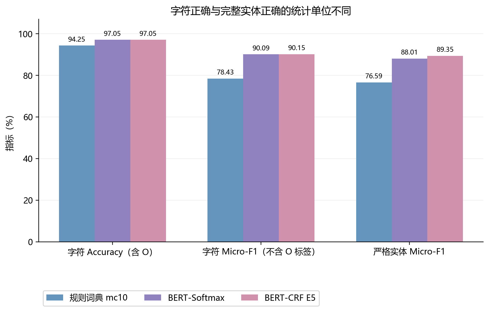

# IMCS-V2-NER：统一预测校验与评估

这是 NLP 课程项目的评估部分：接收规则词典、BERT-Softmax 和字符级 BERT-CRF 的字符 BIO 预测，先校验交付，再按同一口径评分、比较并定位错误。评估负责人组织接口、实现核验、重评分和结果复核；模型训练及词典构建由对应模型负责人完成。代码含 AI 辅助，职责与逐文件来源见[来源与贡献](docs/source_and_contributions.md)。本目录为已审核的评估材料，个人贡献不包含其他成员的模型训练；逐文件作者署名仍待团队确认，尚未授予开源许可。

## 核心实现

- `src/validate_predictions.py`：JSON、完整 ID 集合、原字符长度、11 标签及合法 BIO 检查。
- `src/ner_metrics.py`、`src/evaluate_predictions.py`：严格 span TP/FP/FN、实体 micro P/R/F1、逐字符指标及五类统计。
- `src/run_evaluation_batch.py`：校验→评分→错误定位→元数据核查→同协议比较；其余源码为上述流程的真实依赖。
- `tests/`：合成样本下的原有校验、指标、拒绝行为及流水线回归测试；[公开覆盖范围](docs/reproducibility.md)。

## 同一官方 dev 的结果

833 对话、33,267 句、441,339 字符、23,578 金标实体。以下为真实预测的既有统一评分，百分数显示；CSV 保存未四舍五入的 0—1 数值。

|方法|实体 Precision|实体 Recall|实体 Micro-F1|
|---|---:|---:|---:|
|规则词典 mc10|75.6379%|77.5723%|76.5929%|
|BERT-Softmax|85.3195%|90.8813%|88.0127%|
|字符级 BERT-CRF|87.5743%|91.1994%|89.3501%|

三套完整流程有不同的对齐、监督与训练配置，比较不是只增减 CRF 一层的消融。Softmax 内部 val 的三 seed 学习率均值为：3e-5，88.5858%；5e-5，88.8397%。参数原记录、规则阈值扫描及外部平台成绩分别保存在 `results/`，数据集和证据层级见[结果来源](docs/results_provenance.md)。



## 在 CPU 上运行

Python 3.10+，无需安装第三方包。在本目录根部执行：

```bash
python -X utf8 src/run_evaluation_batch.py --manifest examples/pipeline_validation/evaluation_runs.json --output-dir outputs/synthetic_batch
```

预期 `SUCCESS self_check= PASS`。三条**人工合成**接口的实体 F1 分别为 0、4/9、0.8；这不是三模型的真实成绩。其他命令：

```bash
python -X utf8 -m unittest discover -s tests -v
python -X utf8 src/validate_predictions.py --data examples/scorer_validation/data_dev.json --predictions examples/scorer_validation/predictions_dev.json --split dev --report outputs/synthetic_validation.json
python -X utf8 src/evaluate_predictions.py --data examples/scorer_validation/data_dev.json --predictions examples/scorer_validation/predictions_dev.json --split dev --purpose scorer_validation --output-dir outputs/synthetic_score
```

最小评分预期 TP=2、FP=2、FN=3、F1=4/9。合成样例完全确定，无随机训练；原数据划分 seed=42，学习率组 seed=42/1/2。

## 数据与复现范围

数据请从[天池原数据入口](https://tianchi.aliyun.com/dataset/95414)自行获取，使用前核对当前许可、用途与下载条件。本包不再分发原始数据、真实 ID、逐样本预测、错误案例、模型权重或完整训练日志。公开数据不等于获得再次分发医疗对话的授权。

公开样例与评估程序可独立运行。真实 dev 重评分还需合法取得平台版数据及经授权的原预测；模型从输入到预测的全流程另需训练方代码、权重、Tokenizer 和环境。Softmax 正式权重与原 Tokenizer 尚缺；本包不能单独重训或重现全部模型成绩。test 无公开金标，代码拒绝本地评分。

[评价协议](docs/evaluation_protocol.md) · [复现步骤与测试范围](docs/reproducibility.md) · [实际工作记录](docs/evaluation_work_summary.md)

## 训练数据特征与评分可信度

[research/data_study](research/data_study/README.md)正式保存2026年10月22日研究：2225组内部训练对话、88842句、62671个实体的统计与4图5表；八个合法人工场景的TP/FP/FN和P/R/F1三方核验，以及独立19项研究测试。原138项与公开135项的范围、来源哈希和复核命令在研究README中分别说明。
