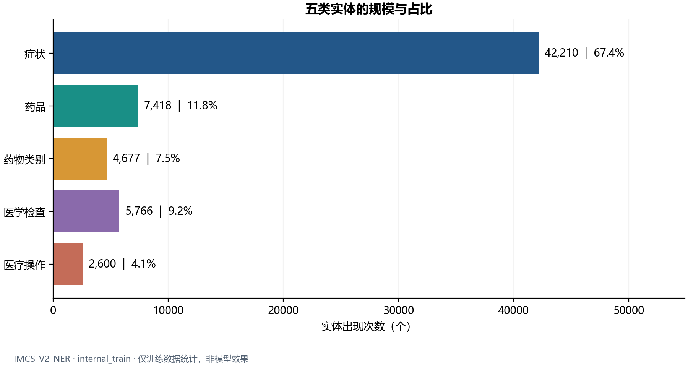
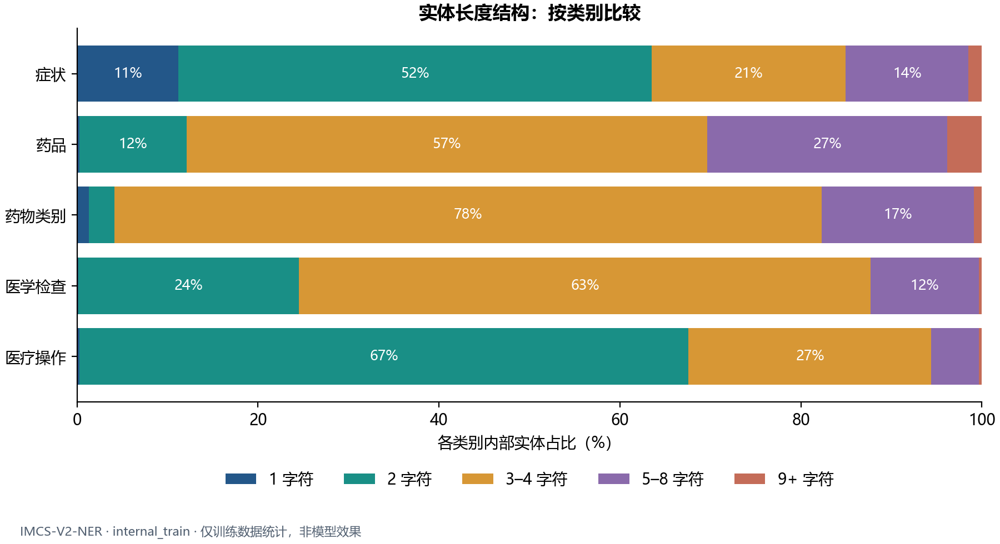
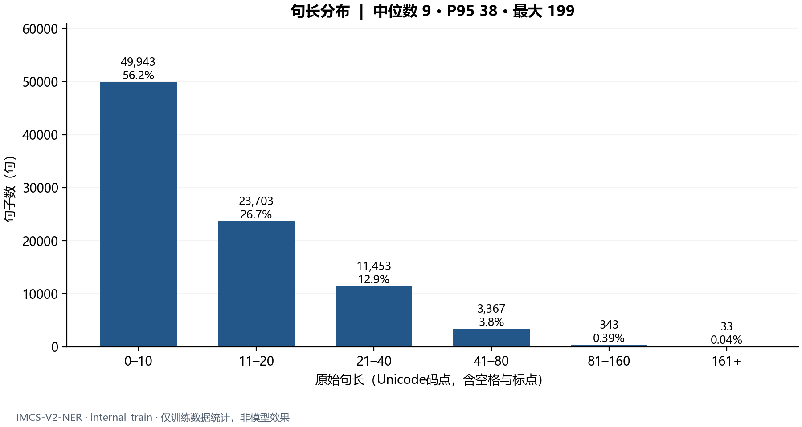
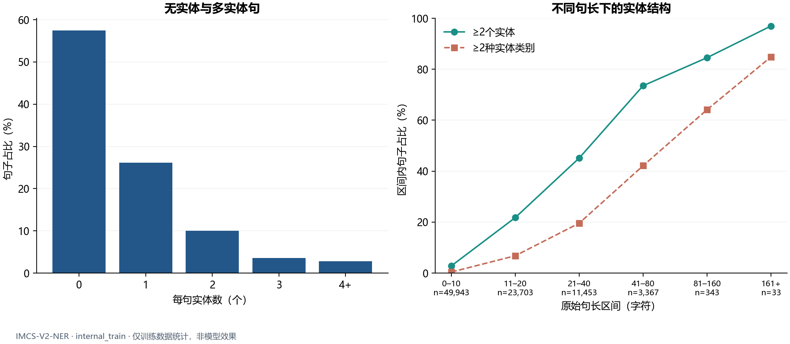

# 训练数据特征研究与评分可信度补充核验

本目录交付2026年10月22日已完成的研究成果：内部训练集的聚合统计、四张图和五份CSV，以及八个人工评分场景的三方对照。研究用于理解数据特征和核验严格实体评分，含AI辅助与人工检查。数据统计、评分实现、来源协议和真实模型成绩分别留存。

## 已核实的训练数据事实

统计仅使用固定的internal_train；按完整对话共用seed=42的2225/247内部train/val名单。internal_val用于调参与选模，官方dev用于模型确定后的独立评估。

|项目|实际结果|
|---|---:|
|内部训练对话 / 句子|2225 / 88842|
|原始Unicode字符 / 实体出现位置|1153312 / 62671|
|症状实体占比|67.35%|
|O字符占比|83.17%|
|多实体句占比|16.36%（14533句）|
|直接相邻实体|1737对，其中同类1519对|
|句长中位数 / P95|9 / 38|

完整定义与未舍入值见[statistics.json](outputs/20261022T175736_profile_l4is4ju_/statistics.json)。实体按类型及原始字符半开区间`[start,end)`计数；相邻指同一句两连续实体满足`left.end == right.start`，句长含原空格和标点。五份CSV为`entity_types`、`entity_lengths`、`sentence_complexity`、`entities_per_sentence`、`adjacent_type_pairs`。

## 四张图与底表

四图均复用原2026年10月22日产物，提供PNG及同名SVG；没有重绘或改动数字。









五份CSV和图原件位于[outputs/20261022T175736_profile_l4is4ju_/](outputs/20261022T175736_profile_l4is4ju_/)。

## 八个人工评分场景

[评分可信度实验说明](评分可信度实验说明.md)逐项给出原始金标和预测BIO、手工TP/FP/FN、Precision/Recall/F1及两评分实现的实测值，并详解相邻同类、合并、拆分三种情况。

八个合法场景的整体计数与P/R/F1全部一致。每例含五类各一个正确实体的固定锚点，显式贡献5个TP；典型合并得到5/1/2、拆分得到5/2/1，F1同为10/13。参考程序固定到作者仓库commit `8d512c6635029bf068712d62cf2428e65c5e4a58`，只执行其实体评分段。

[原评分对照记录](reliability_runs/20261022T175006104092_z82c4ymo/scoring_crosscheck.json)保留8个合法输入、逐类结果和源码哈希；无实体与非法BIO的协议边界另外记录。

## 脚本、测试与复核命令

在仓库的`evaluation/`目录运行。评分及测试主要使用标准库，绘图另需matplotlib；真实数据从[天池](https://tianchi.aliyun.com/dataset/95414)自行取得。固定作者源码由现有准备脚本下载并校验SHA，保存在git忽略的本地路径。

```bash
cd evaluation
python -B -X utf8 tests/prepare_author_reference.py
python -B -X utf8 -m unittest discover -s tests -v
python -B -X utf8 -m unittest discover -s research/data_study -p "test_*.py" -v
python -B -X utf8 research/data_study/verify_scoring.py --output-dir local_analysis/scoring_recheck
```

公开原评估套件为135项，新研究套件为19项（数据统计12项、评分核验7项）。历史本地完整评估套件138项包含额外3项作者参考测试；不能把公开135当作历史138，也不能把八场景再次加入测试数量。

若合法取得平台包与团队固定名单，可在同一目录按已有名单统计：

```bash
python -B -X utf8 research/data_study/profile_data.py --data /path/to/IMCS-V2-NER.zip --split-manifest /path/to/split_v1.json --output-dir local_analysis/data_profile
```

`profile_data.py`支持已有split JSON或团队接口ZIP。每次创建唯一输出目录，原数据与历史成果只读；统计口径不改变原字符和BIO。

## 历史运行记录和公开副本

2026年10月22日两条原测试命令均退出0：[原138项日志](acceptance/20261022T175736_c58d67/existing_regression.txt)与[新增19项日志](acceptance/20261022T175736_c58d67/new_study_tests.txt)，分别记录14.695秒和0.428秒。独立实现的七项训练集聚合核对见[原核对记录](test_evidence/20261022T175447132117/independent_train_check.json)。

CSV、PNG、SVG、四个脚本及单元测试文本与本地原件逐字节一致。评分CLI输出中本地绝对路径已替换为占位符，输出状态保留。源码按现存版本交付；历史运行记录中的脚本哈希保留当时原值。当前统计脚本与历史运行哈希不同，本轮对现存源码的轻量复核和发布副本测试单独保存，不冒充原运行版本。公开JSON对本地绝对路径、私有名单容器位置做占位替换，保留结果与历史哈希；每份`publication_note`注明原件SHA及变换范围，[发布清单](publication_manifest.json)给出原件与公开副本哈希。`run_manifest`中的历史产物SHA仍对应原始本地记录，公开副本SHA以发布清单为准。

本目录不含原始医疗对话、真实样本ID清单、逐样本预测、模型权重、账户资料及作者评分源码。图中聚合统计只说明数据分布；人工评分核验只检验所列输入上的评分一致性。

## 数据来源与下一轮报告材料

[天池与GitHub数据来源核查](天池与GitHub数据来源核查.md)记录官方版本说明、可比train/dev字段与标注差异，以及适合附录D.1使用的建议文字。本轮未修改正式实验报告。
